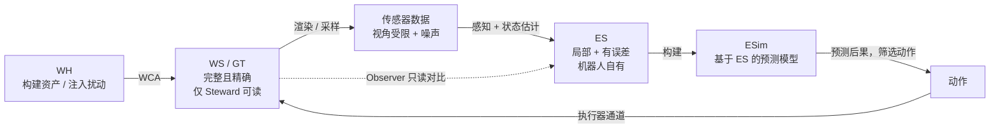
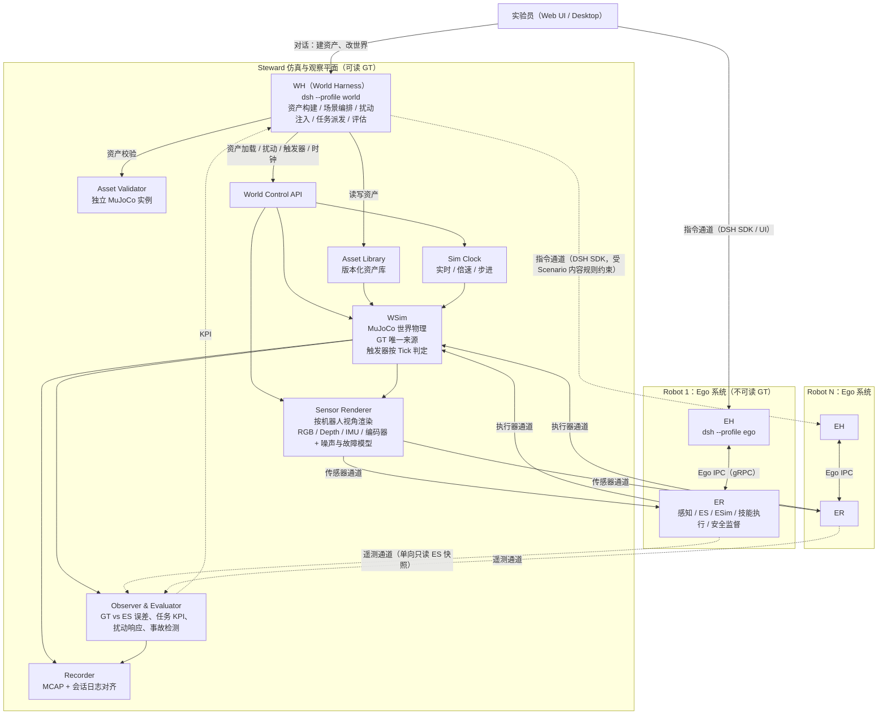
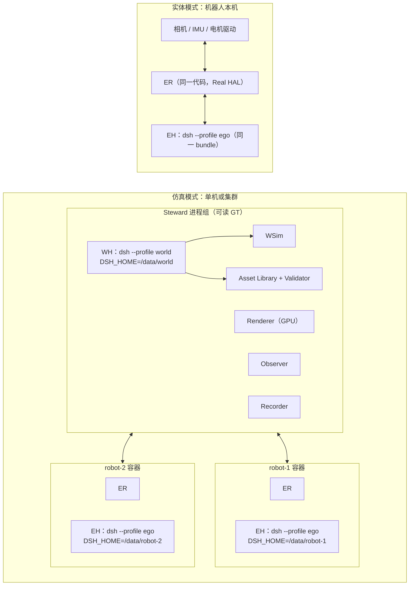
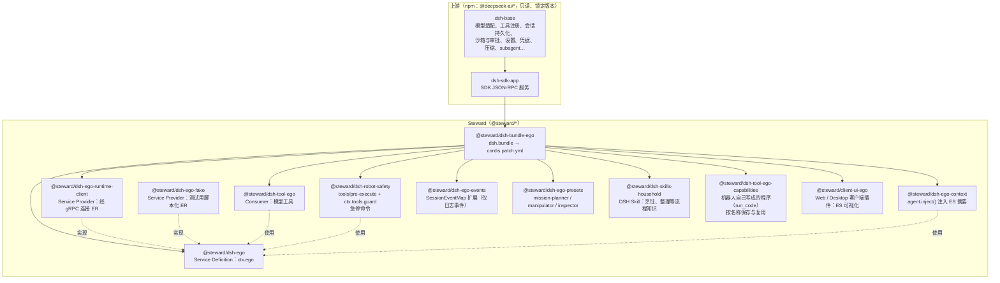
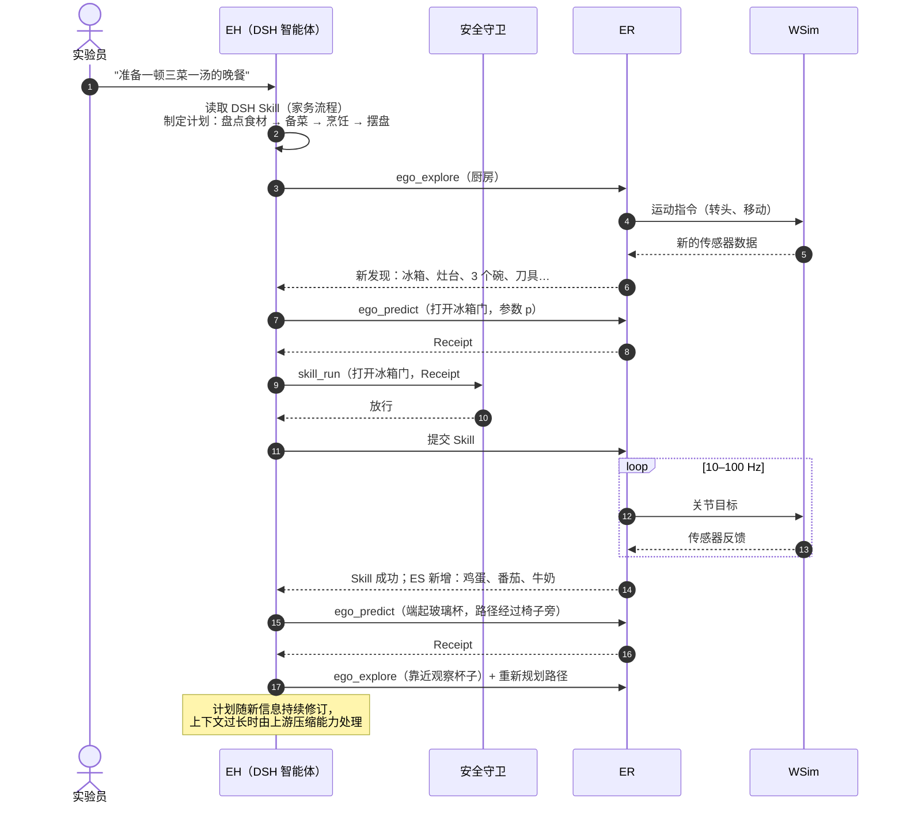
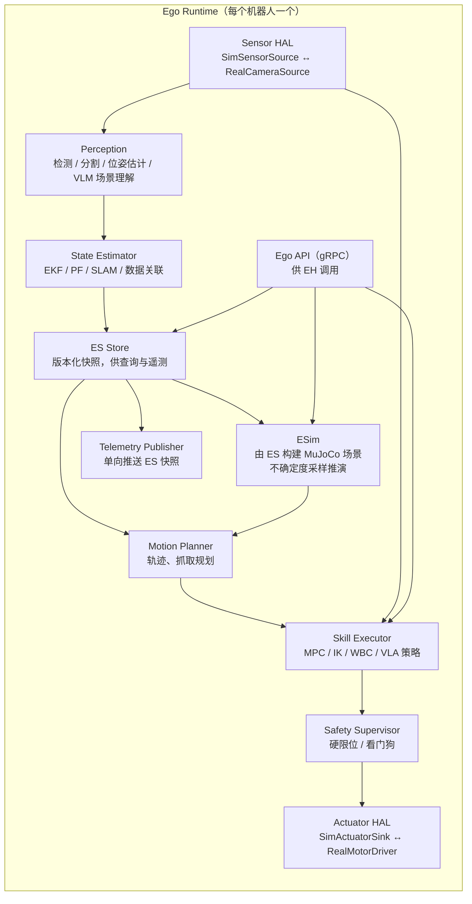
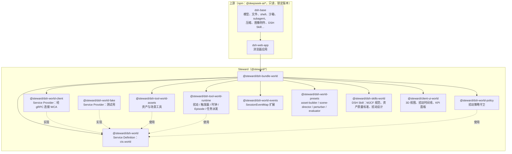
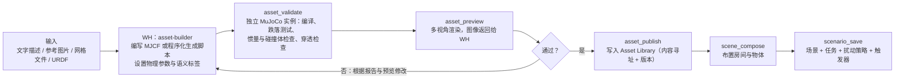
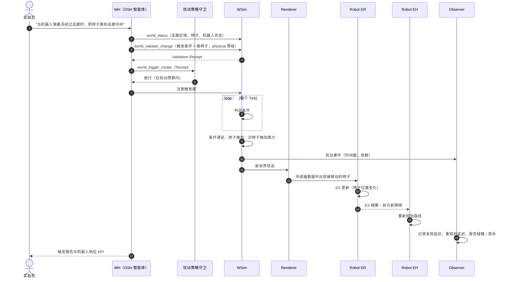
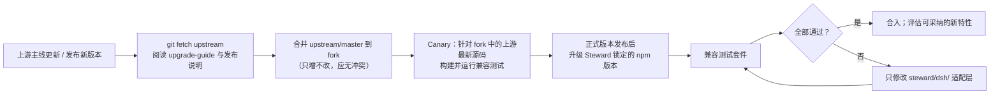

# Steward：基于 DeepSeek Harness 的具身智能机器人系统设计

## 1. 摘要

Steward 是一个用于构建、仿真和观察通用机器人自主行为的系统。它由两部分组成：

- **Steward 仿真与观察平面**：维护世界的 GT（Ground Truth，真实世界状态），模拟场景、物体与一个或多个机器人，为每个机器人渲染传感器输入，执行机器人发出的动作，并对比 GT 与各机器人的自我认知，评估其行为。该平面包含一个 WH（World Harness，世界智能体），它是一个 DeepSeek Harness 实例，用于构建仿真资产、编排场景，并在仿真运行中交互式地引入动态变化，干扰机器人的行为条件。
- **Ego 系统（机器人自我系统）**：每个机器人一套。它只通过自身传感器感知世界，持续维护一份局部且有误差的 ES（Ego-State，自我态），用 ESim（Ego-Simulation，自我仿真）预测动作后果，并用基于 DeepSeek Harness 的智能体完成长时任务规划（例如"准备一顿完整的晚餐"）、逐步身体控制和精细操作。

Ego 系统是本项目的核心产物，目标是通用机器人。仿真环境中的传感器输入来自 Steward 渲染；部署到实体机器人时，同一套 Ego 系统改为接入真实相机与执行器，上层代码不变。

本设计的硬性约束：**对 DeepSeek Harness 零侵入**。Steward 不修改任何上游文件，只通过 Harness 公开的扩展点（插件、bundle、profile、patch、SDK）构建，从而持续获得上游新特性。

## 2. 术语与缩写

### 2.1 Steward 领域术语

| 术语 / 缩写 | 英文全称 | 定义 |
|---|---|---|
| Steward | Steward | 本系统名称；也指仿真与观察平面整体。 |
| WS | World State | 世界状态：场景、物体、机器人身体在某一时刻的完整物理状态。 |
| GT | Ground Truth | 真实值。仿真中 WS 即 GT，仅 Steward 平面可读。 |
| WSim | World Simulator | 世界仿真器：推进 WS 的物理引擎进程，是 GT 的唯一权威来源。 |
| WH | World Harness | 世界智能体：Steward 平面中的 DeepSeek Harness 实例。负责资产构建、场景编排、运行中扰动注入、任务派发与评估。它可读 GT，但不在物理回路中。 |
| WCA | World Control API | 世界控制接口：WSim 与 Sensor Renderer 对 WH 开放的受控操作集合（加载资产、施加扰动、管理触发器、控制时钟）。只在 Steward 平面内部可达。 |
| Asset | Simulation Asset | 仿真资产：物体、家具、房间等的几何、碰撞体、物理参数、外观与语义描述。 |
| Asset Library | Asset Library | 资产库：版本化、内容寻址的资产存储，供场景引用。 |
| Scenario | Scenario | 一次实验的场景定义：环境、物体、机器人初始状态、任务、扰动策略、触发器与评估规则。 |
| Perturbation | Perturbation | 扰动：仿真运行中对世界施加的变化（移动物体、开门、改变光照、引入行人、传感器故障等），用于干扰机器人的行为条件。 |
| Trigger | Perturbation Trigger | 扰动触发器：由 WH 编写、由 WSim 每个 Tick 判定的条件规则，条件满足时施加指定扰动。 |
| Perturbation Policy | Perturbation Policy | 扰动策略：Scenario 规定允许的扰动类型、合理性等级、幅度、频率与禁区。 |
| Plausibility Level | Plausibility Level | 合理性等级：扰动在真实世界中发生的可能性分级，分为 physical、staged、god-mode，见 6.14。 |
| Validation Receipt | Validation Receipt | WSim 对拟议扰动完成干运行校验后返回的凭据，WH 的守卫据此放行扰动。 |
| Ego | Ego System | 机器人自我系统：一个机器人的感知、自我态、自我仿真、规划与控制的整体。 |
| ES | Ego-State | 自我态：机器人仅凭自身感知重建的近似世界状态，包含自身身体状态。它是局部的（未见过的物体不在其中）且有误差的（位置估计有不确定度）。 |
| ESim | Ego-Simulation | 自我仿真：机器人基于 ES 构建的内部物理模型，用于预测动作后果、做反事实推演。 |
| ER | Ego Runtime | 自我运行时：Ego 系统中非 LLM 的实时部分（感知、状态估计、ESim、技能执行、安全监督），独立于 Harness 的进程。 |
| EH | Ego Harness | 自我智能体：每个机器人一个 DeepSeek Harness 实例，负责任务理解、长时规划、技能编排与异常处理。 |
| EA | Ego Agent | 运行在 EH 中的智能体会话（Session）。 |
| ES Error | Ego-State Error | ES 相对 GT 的误差，只能由 Steward 平面计算。 |
| SceneState | Scene State | WS 与 ES 共用的场景数据结构，见 4.2。 |
| Entity | Entity | 场景中一个可独立存在的物理对象（墙体、家具、杯子、机器人、衣服）。 |
| Link | Link | 实体中的一个刚体部件（柜体、抽屉、刀片、机械臂的一节）。 |
| Joint | Joint | 连接两个 Link 的关节（固定、旋转、滑动、球铰）。 |
| Deformable | Deformable Body | 柔性体（布料、软体、绳线）。 |
| Spatial Layer | Spatial Layer | 场景级空间表示（占据、TSDF、ESDF、语义区域），存放不属于任何已识别实体的信息。 |
| Observer | Observer | Steward 中只读采集 GT 与各机器人 ES 快照并计算指标的组件。 |
| Episode | Episode | 一个 Scenario 的一次完整运行。 |
| Tick | Tick | 仿真时钟的一个固定步长。 |
| Skill | Skill | 可复用的中层动作能力，例如"抓取杯子""打开冰箱门"，由 ER 实时执行，EH 只负责选择与参数化。注意与 Harness 的 skill（指令文档）区分，后文称后者为 DSH Skill。 |
| Belief | Belief | 概率意义上的状态估计，ES 中每个物体的位姿以均值和协方差表示。 |
| Affordance | Affordance | 物体可被如何操作的属性，例如可抓取、可倾倒、易碎。 |
| Prediction Receipt | Prediction Receipt | ESim 完成一次动作后果预测后返回的凭据，EH 的安全守卫据此放行动作。 |

### 2.2 机器人与仿真技术缩写

| 缩写 | 英文全称 | 定义 |
|---|---|---|
| POMDP | Partially Observable Markov Decision Process | 部分可观测马尔可夫决策过程；机器人只能观测部分状态，正是 ES 的理论框架。 |
| SLAM | Simultaneous Localization and Mapping | 同时定位与建图。 |
| VIO | Visual-Inertial Odometry | 视觉惯性里程计。 |
| EKF | Extended Kalman Filter | 扩展卡尔曼滤波，用于融合观测更新物体位姿 belief。 |
| PF | Particle Filter | 粒子滤波，适合多模态 belief。 |
| DoF | Degrees of Freedom | 自由度；6-DoF 位姿即三维位置加三维姿态。 |
| SE(3) | Special Euclidean group in 3D | 三维刚体变换群，位姿的数学表示。 |
| IK | Inverse Kinematics | 逆运动学。 |
| MPC | Model Predictive Control | 模型预测控制。 |
| WBC | Whole-Body Control | 全身控制。 |
| VLA | Vision-Language-Action model | 视觉-语言-动作模型，直接输出低层动作的策略网络。 |
| VLM | Vision-Language Model | 视觉语言模型，用于场景理解与开放词汇检测。 |
| LLM | Large Language Model | 大语言模型。 |
| HAL | Hardware Abstraction Layer | 硬件抽象层，屏蔽仿真传感器与真实传感器的差异。 |
| Sim2Real | Simulation to Reality | 从仿真迁移到实体机器人。 |
| MuJoCo | Multi-Joint dynamics with Contact | 开源刚体与接触动力学引擎，推荐作为 WSim 与 ESim 的物理内核。 |
| MJCF | MuJoCo XML Format | MuJoCo 的模型描述格式，资产的主要物理描述格式。 |
| mjSpec | MuJoCo model specification API | MuJoCo 的程序化模型编辑接口，可在运行时修改模型并重新编译，是运行中增删资产的候选实现方式。 |
| URDF | Unified Robot Description Format | 常见的机器人描述格式，可转换为 MJCF。 |
| GLB / OBJ / STL | — | 常见三维网格格式，用于资产的外观与碰撞几何。 |
| RGB-D | Red Green Blue + Depth | 彩色图像加逐像素深度的相机输出。 |
| SDF | Signed Distance Field | 有符号距离场：空间中每点到最近表面的有符号距离。 |
| TSDF | Truncated Signed Distance Field | 截断符号距离场，常用于多帧深度融合与表面重建。 |
| ESDF | Euclidean Signed Distance Field | 欧氏符号距离场，常用于运动规划中的碰撞距离与梯度。 |
| Voxel | Volume Element | 体素：三维规则网格中的一个格子。 |
| NEES | Normalized Estimation Error Squared | 归一化估计误差平方，用于检验估计的不确定度是否校准。 |
| IoU | Intersection over Union | 交并比，用于比较两个占据区域的重合程度。 |
| Chamfer Distance | Chamfer Distance | 两个点集之间双向最近点距离的平均，用于比较几何形状。 |
| MCAP | MCAP | 机器人领域常用的多通道时间序列日志格式。 |
| RT | Real-Time | 实时，指有确定时限的控制回路。 |
| IPC | Inter-Process Communication | 进程间通信。 |
| gRPC | gRPC Remote Procedure Call | 基于 HTTP/2 与 Protobuf 的 RPC 框架。 |
| ROS 2 / DDS | Robot Operating System 2 / Data Distribution Service | 机器人中间件及其底层发布订阅协议，可作为 ER 内部或 Sim2Real 的传输层。 |
| KPI | Key Performance Indicator | 评估指标。 |
| ACL | Anti-Corruption Layer | 防腐层：把外部系统的接口隔离在少量适配模块内，避免其变化扩散到业务代码。 |

### 2.3 DeepSeek Harness 术语

| 术语 / 缩写 | 定义 |
|---|---|
| DSH | DeepSeek Harness，命令行为 `dsh`。 |
| Cordis | DSH 底层插件框架；所有能力（模型适配、工具、会话日志、agent loop 本身）都是插件。 |
| Plugin | 向共享上下文贡献服务、事件监听和可撤销副作用的单元。 |
| Profile | 存放在 `$DSH_HOME/profiles/<name>` 的命名组合：有序 bundle 列表、仓外插件依赖和用户 `cordis.patch.yml`。 |
| Bundle | 携带一份 Cordis 配置 patch 及其插件代码的 npm 包，在 `package.json` 中以 `"dsh": { "bundle": { "patch": "./cordis.patch.yml" } }` 声明。 |
| Patch | 按行 id 替换或插入配置行的 YAML 层；叠加顺序为 profile 的 bundle、profile patch、home patch、启动时 `--patch`。 |
| Capability Seam | 可替换能力的三角色结构：Service Definition（接口）、Service Provider（实现）、Consumer（使用方，通常是模型工具）。 |
| Session | 一次持久化对话，底层是只追加的事件日志。 |
| Session Event | 日志中的一条事件；插件可通过 `SessionEventMap` 声明合并增加自己的事件类型。 |
| Agent Preset | 用 Cordis YAML 定义的一组智能体子插件，会话可选择其一。 |
| Subagent | 由主智能体派生的子智能体，用于委派子任务。 |
| Guard | 工具执行前的拦截与否决机制：`tools/pre-execute` 是可排序的策略层，`ctx.tools.guard()` 提供不可被后续监听器推翻的最终否决。 |
| SDK | DSH 的 TypeScript 与 Python SDK，通过 stdio JSON-RPC 启动并驱动一个 `dsh` 运行时。 |
| MCP | Model Context Protocol，DSH 可经 `dsh-mcp-client` 把外部 MCP 服务器的工具注册为模型工具。 |
| Upstream | `deepseek-ai/deepseek-harness` 官方仓库与其发布的 npm 包。 |

## 3. 设计目标与非目标

### 3.1 目标

1. **信息隔离**：机器人永远读不到 GT。Ego 系统只能经传感器通道获得信息，经执行器通道作用于世界。
2. **ES 收敛**：持续感知使 ES 的误差随时间下降、覆盖率随探索上升，且该过程可被 Steward 定量观察。
3. **后果预测**：动作执行前经 ESim 推演，阻止可预见的意外（绊倒家具、打碎玻璃杯、碰倒人）。
4. **长时任务**：能接受"准备一顿晚餐"这类多小时、多子目标的复杂指令，具备规划、执行、监控、重规划能力。
5. **Sim2Real 一致**：同一套 Ego 系统可在仿真和实体机器人上运行，差异只在 HAL 层。
6. **多机器人**：一个世界中可并存多个机器人，各自拥有独立 ES 与 EH。
7. **可编程世界**：用 WH 以自然语言加代码的方式构建资产与场景，并在仿真运行中交互式或按条件注入扰动，系统性地检验机器人的鲁棒性。
8. **上游兼容**：零侵入 DSH，随上游升级获得新能力。

### 3.2 非目标

- 不把 LLM 放进任何实时回路：EH 不直接输出电机指令，WH 不直接推进物理步进。
- 不修改 DSH 的 agent loop、会话格式或任何上游包。
- 不让 Steward 为机器人"代为感知"；Steward 只提供传感器原始数据（图像、深度、IMU、关节编码器等）。
- 不向机器人预告扰动；机器人只能通过自己的传感器发现世界的变化。

## 4. 核心概念

### 4.1 WS 与 ES 的关系



ES 与 GT 有三类差异，Steward 分别度量：

| 差异 | 含义 | 度量示例 |
|---|---|---|
| 覆盖缺失 | 未见过的物体、未探索的空间不在 ES 中 | 物体召回率、已探索空间比例 |
| 估计误差 | 已知物体的位姿、尺寸、类别有偏差 | 位置误差（米）、姿态误差（度）、类别准确率 |
| 过时状态 | 物体被他人或扰动移动后 ES 尚未更新 | 状态陈旧时间、扰动发现延迟 |

WH 注入的扰动专门制造第三类差异：世界变了，机器人必须自己发现。

### 4.2 统一场景数据模型（WS 与 ES）

#### 4.2.1 设计原则：一套结构，两种实例

WS 与 ES 使用**同一套数据结构**，称为场景状态 `SceneState`。区别只在于两个实例参数：

| 实例 | 记法 | id 类型 | 数值含义 | 完整性 | 坐标系 |
|---|---|---|---|---|---|
| WS | `SceneState<'world'>` | `WorldEntityId`（GT id） | 精确真值，不带不确定度 | 完整：世界中所有实体 | `world` |
| ES | `SceneState<'ego'>` | `EgoEntityId`（机器人自行分配） | 估计值，带不确定度、来源与观测时间 | 局部：只含已感知或已推断的实体 | 机器人自己的 `map` 坐标系 |

这样做的好处：

- **对比直接**：Observer 只需把 ES 实体关联到 WS 实体，就能逐字段计算误差，不需要两套结构之间的转换。
- **代码共用**：WSim 与 ESim 都从同一结构构建 MuJoCo 模型；可视化、校验、序列化共用一份实现。
- **一致性靠构造保证**：结构定义在独立的 `scene-schema` 包中（Protobuf 为权威定义，Python、C++、TypeScript 代码由它生成），`world-protocol` 与 `ego-protocol` 都引用它，而不是各写一份。
- **隔离可检查**：两种 id 是不同的品牌类型。ES 中出现 `WorldEntityId` 或资产引用，校验器直接拒绝，作为信息泄漏的自动检测。

类型总数刻意控制为 **8 个核心类型**：

| 类型 | 作用 |
|---|---|
| `Est<T>` | 可估计量的统一包装：WS 中只有真值，ES 中附带不确定度 |
| `SceneState` | 场景快照容器：实体、关系、空间层 |
| `Entity` | 场景中一个独立的物理对象：墙体、家具、杯子、剪刀、机器人、衣服 |
| `Link` | 刚体部件 |
| `Joint` | 连接两个 Link 的关节 |
| `Deformable` | 柔性体 |
| `Geometry` | 几何表示（基本体、网格、点云、SDF） |
| `Relation` | 实体之间的关系：附着、支撑、包含 |

另有两个仅用于机器人本体的部件说明 `Sensor`、`Actuator`，以及场景级的空间层 `SpatialLayers`（4.2.6）。

**物体类型不是新的数据类型**。墙、抽屉柜、剪刀、机器人的差别全部由字段取值表达：根关节是否固定、有几个 Link 和 Joint、关节是否带执行器、body 是刚体树还是柔性体。

#### 4.2.2 `Est<T>`：可估计量

```ts
interface Est<T> {
  value: T                  // WS：真值；ES：估计值（连续量取均值，离散量取众数）
  unc?: Uncertainty<T>      // WS：必须缺省；ES：按需提供
  t?: Time                  // ES：最后一次被观测或更新的时间
  src?: 'observed' | 'fused' | 'prior' | 'inferred' | 'predicted'  // ES：信息来源
}

type Uncertainty<T> =
  | { kind: 'gaussian'; cov: number[] }                        // 连续量；位姿为切空间 6x6 协方差
  | { kind: 'categorical'; p: Record<string, number> }         // 离散量：类别、关节类型、开关状态
  | { kind: 'interval'; lo: T; hi: T }                         // 只知道范围：关节限位、质量
  | { kind: 'samples'; samples: T[]; weights?: number[] }      // 多峰分布：粒子
```

所有"机器人可能估错"的字段都用 `Est<T>` 包装：位姿、关节角、尺寸、类别、物理参数、关节类型，甚至"这张桌子是否固定在地上"。ESim 的不确定度采样（4.3）直接从这些 `unc` 中抽样。

#### 4.2.3 核心结构

```ts
type Mode = 'world' | 'ego'

interface SceneState<M extends Mode> {
  mode: M
  version: number                  // 单调递增
  stamp: Time                      // 仿真时间或真实时间
  frame: M extends 'world' ? 'world' : 'map'
  entities: Entity<M>[]
  relations: Relation<M>[]
  layers: SpatialLayers<M>
  self?: EntityId<M>               // ES：机器人自身对应的实体
}

interface Entity<M extends Mode> {
  id: EntityId<M>                  // WorldEntityId 或 EgoEntityId
  role: 'environment' | 'object' | 'robot' | 'actor'   // actor：行人、宠物等自主运动实体
  category: Est<string>            // 墙、桌子、杯子、衬衫…
  pose: Est<Pose>                  // 根部件在场景坐标系中的位姿
  twist?: Est<Twist>               // 根部件速度
  body: RigidTree<M> | Deformable<M>
  stateVars: Record<string, Est<Scalar>>   // 非几何状态：开关、温度、填充量、是否破损
  existence: number                // WS 恒为 1；ES 为存在概率
  asset?: AssetRef                 // 仅 WS：资产库引用
}

interface RigidTree<M extends Mode> {
  kind: 'rigid'
  root: Est<'fixed' | 'planar' | 'free'>   // 根部件与世界的连接：固定 / 地面平面运动 3-DoF / 自由 6-DoF
  links: Link<M>[]                 // links[0] 为根部件
  joints: Joint<M>[]               // 树结构：每个非根 Link 恰有一个父 Joint
  rootActuator?: RootActuator      // 根部件的驱动：移动底盘驱动 planar 根的 x、y、yaw
}

interface Link<M extends Mode> {
  id: LinkId
  name: string                     // 柜体、抽屉、门扇、刀片、上臂…
  geometry: {
    visual?: Geometry[]            // 外观，用于渲染
    collision?: Geometry[]         // 碰撞与接触，用于物理仿真与规划
    observed?: Geometry[]          // 仅 ES：实际观测到的几何（点云、融合表面）
  }
  inertial?: Est<Inertial>         // 质量、质心、惯量
  material?: Est<Material>         // 摩擦、恢复系数、易碎阈值
  affordances: Est<Affordance>[]   // 部件级：把手可抓、刀刃可切、门可推
  sensors?: Sensor[]               // 仅机器人
}

interface Joint<M extends Mode> {
  id: JointId
  parent: LinkId
  child: LinkId
  type: Est<'fixed' | 'revolute' | 'prismatic' | 'ball'>
  origin: Est<Pose>                // 关节坐标系在父部件中的位姿
  axis?: Est<Vec3>
  limits?: Est<{ lo: number; hi: number }>
  q: Est<number[]>                 // 关节位置
  qd: Est<number[]>                // 关节速度
  dynamics?: Est<{ damping: number; friction: number; stiffness: number; springRef?: number }>
  locked?: Est<boolean>            // 门锁、抽屉卡住
  actuator?: Actuator              // 有执行器即为可驱动关节（机器人、行人）
}

interface Deformable<M extends Mode> {
  kind: 'deformable'
  model: 'cloth' | 'volume' | 'cable'   // 布料 / 软体 / 绳线
  rest: GeometryRef                // 静止形状与拓扑（网格）
  nodes?: Est<Vec3[]>              // 当前节点位置：WS 完整；ES 通常缺省
  keypoints: Est<Keypoint[]>       // 语义关键点：领口、袖口、衣角、绳端
  surface?: Geometry               // ES：观测到的表面（点云或粗网格）
  material: Est<{ stretch: number; bend: number; shear: number; damping: number; density: number }>
}

interface Relation<M extends Mode> {
  type: 'attached' | 'supported-by' | 'contained-in'
  a: Anchor<M>                     // 实体 + 可选的部件 id 或柔性体节点索引
  b: Anchor<M>
  mode?: 'rigid' | 'pinned'        // attached 专用：刚性固连（被抓取）或点约束（衣服挂在衣架上）
  derived: boolean                 // true：由接触与几何推导；false：物理约束
  confidence?: number              // 仅 ES
}

interface Sensor {                 // 机器人部件上的传感器
  id: SensorId
  kind: 'rgb' | 'depth' | 'rgbd' | 'imu' | 'force-torque' | 'tactile' | 'encoder'
  mount: Pose                      // 相对所在部件；光轴为 mount 坐标系 +x，+z 朝上
  intrinsics?: CameraIntrinsics
  rateHz: number
}

interface Actuator {               // 关节执行器
  kind: 'position' | 'velocity' | 'torque'
  limits: { effort: number; velocity: number }
  gear?: number
  gains?: { kp?: number; kv?: number; armature?: number }   // 仿真控制增益，实体机器人由驱动器自行整定
}

interface RootActuator {           // planar 根的三个自由度各一组参数，顺序为 x、y、yaw
  kind: 'position'
  limits: { effort: number[]; velocity: number[] }
  gains: { kp: number[]; damping: number[] }
}
```

大体积数据（网格、点云、体素块）不内嵌在状态消息中，而以内容寻址的 `GeometryRef`（数据块哈希）引用，与资产库和 Recorder 共用同一块存储。这样状态消息可以高频传输，大数据按需拉取并可缓存。

#### 4.2.4 各类物体的表示方式

全部物体只用 `Entity` 表示，`body` 只有两种：`RigidTree`（刚体树，单个刚体是只有一个 Link 的树）和 `Deformable`（柔性体）。

| 物体 | body | root | Link / Joint | 执行器 | 要点 |
|---|---|---|---|---|---|
| 墙壁、地面、天花板 | `RigidTree` | `fixed` | 每面墙一个 Link，彼此以 `fixed` 关节相连 | 无 | 推荐整个建筑外壳作为一个 `environment` 实体；碰撞几何用盒体或平面，外观用网格 |
| 固定障碍物（没有可开部件的柜子、固定的台面） | `RigidTree` | `fixed` | 1 个 Link，无 Joint | 无 | 与墙体结构相同，只是 `role: 'object'` |
| 可移动刚体（杯子、椅子、碗） | `RigidTree` | `free`（椅子可用 `planar`） | 1 个 Link，无 Joint | 无 | 被推动或被抓取时，pose 变化 |
| 可操控铰接物体（抽屉柜、冰箱、门） | `RigidTree` | `fixed` | 柜体为根 Link；抽屉为子 Link，`prismatic` 关节；门扇为子 Link，`revolute` 关节 | 无（被动） | 限位、阻尼、自动回位弹簧写在 `limits`、`dynamics`；锁写在 `locked`；把手是 Link 上的 `affordance` |
| 房门 | `RigidTree` | — | 作为建筑实体的子 Link，以 `revolute` 关节连接门框 | 无 | 门属于墙，不另建实体 |
| 自由铰接物体（剪刀、钳子、笔记本电脑） | `RigidTree` | `free` | 两片刀身两个 Link，以 `revolute` 关节相连 | 无（被动） | 与抽屉柜的唯一区别是根部件可自由移动 |
| 机器人本体 | `RigidTree` | 移动底盘 `planar`；固定机械臂 `fixed`；人形 `free` | 多个 Link 与 Joint | 可驱动关节带 `Actuator` | `role: 'robot'`；传感器挂在部件上；被抓物体通过 `attached`（`rigid`）关系连接到夹爪部件 |
| 行人、宠物 | `RigidTree` | `planar` 或 `free` | 简化骨架或单个 Link | 由 WSim 行为模型驱动 | `role: 'actor'`；ES 中通常只有 pose、速度与粗略形状 |
| 柔性物体（挂在衣架上的衣服、毛巾、电线） | `Deformable` | — | — | 无 | 衣服与衣架是两个实体，以 `attached`（`pinned`）关系连接：衣服的若干节点固定在衣架部件上 |
| 状态变化（灶台开关、杯中水量、玻璃破碎） | 任意 | — | — | — | 用 `stateVars` 表示，例如 `{ "on": true }`、`{ "fillLevel": 0.6 }`、`{ "broken": true }`；液体与颗粒不做逐粒子建模 |

几个判断规则：

- **固定还是可动**：看 `root`，不看类别。ES 中可以不确定，例如 `root = { value: 'free', unc: { kind: 'categorical', p: { fixed: 0.3, free: 0.7 } } }`，先验来自类别（桌子多半不固定，台面多半固定）。
- **简单物体还是铰接物体**：看 `joints` 是否为空。ES 中一开始可能把抽屉柜当作单个固定 Link，直到看见抽屉缝或拉开抽屉后再细化为两个 Link 加一个 `prismatic` 关节。这种模型细化是 ES 正常的更新方式，结构本身不变。
- **被动还是主动**：看关节有无 `actuator`。机器人与行人有，剪刀与抽屉没有。
- **部件还是独立实体**：能整体脱离、独立移动的是实体（杯子、衣架、衣服），只能绕关节相对运动的是部件（抽屉、门扇、刀片）。

#### 4.2.5 WS 与 ES 的字段差异

| 字段 | WS | ES |
|---|---|---|
| `id` | `WorldEntityId` | `EgoEntityId`，与 GT 无关 |
| `Est.unc` / `t` / `src` | 必须缺省 | 按需提供 |
| `existence` | 恒为 1 | 0–1 的概率 |
| `asset` | 有 | 必须缺省 |
| `geometry.observed` | 缺省 | 有，存放实际观测到的点云或融合表面 |
| `geometry.collision` | 精确碰撞体 | 按不确定度保守放大后的估计碰撞体 |
| `Deformable.nodes` | 完整节点位置 | 通常缺省，用 `keypoints` 与 `surface` 表示 |
| `Relation.derived=false` | 物理约束（抓取、挂钩） | 机器人推断的约束，带 `confidence` |
| `self` | 缺省 | 指向机器人自身实体 |
| 机器人自身的关节角 | 精确 | 来自编码器，不确定度很小 |
| 机器人自身的底盘位姿 | 精确 | 来自定位，不确定度较大 |
| 坐标系 | `world` | 机器人自己的 `map`，与 `world` 之间的变换机器人不知道 |

`scene-schema` 提供两个校验器：`validateWorld` 与 `validateEgo`，分别检查上表规则。遥测通道上的 ES 快照先过 `validateEgo`，发现 GT 字段即判定为泄漏。

Observer 的对比流程：先估计 `world` 与 `map` 之间的变换（用初始位姿真值或点云配准），再按位姿与类别关联实体，然后逐字段计算误差。除位置、姿态、关节角、类别误差外，还计算 NEES（Normalized Estimation Error Squared，归一化估计误差平方），检验机器人报告的不确定度是否校准：误差显著大于协方差所预期的值，说明机器人过度自信。

#### 4.2.6 空间层 `SpatialLayers`

实体是以物体为中心的表示。仍有大量信息不属于任何已识别的实体：哪些空间是空的、哪些还没看过、看到了但还没分割出来的杂物。这些放在场景级空间层中：

```ts
interface SpatialLayers<M extends Mode> {
  occupancy?: VoxelLayer<{ logOdds: number }>   // 3D 占据：空闲 / 占据 / 未知
  tsdf?: VoxelLayer<{ d: number; w: number }>   // 截断符号距离 + 权重：多帧深度融合
  esdf?: VoxelLayer<{ d: number }>              // 欧氏距离场：运动规划的碰撞代价与梯度
  costmap2d?: GridLayer<{ cost: number }>       // 由 occupancy 投影的 2D 导航代价图
  regions: Region[]                             // 语义区域：厨房、走廊（多边形或体积 + 标签）
  unassigned?: GeometryRef                      // 已观测但未归属任何实体的点云
}
```

- ES 中，空间层是主要的感知积累方式。物体从 `unassigned` 中分割并识别出来后，"提升"为实体，几何取自对应的层数据。
- WS 中，空间层可由 GT 计算得到，只用于评估（例如已探索空间比例、占据栅格 IoU）和触发器的区域判定，不是 WSim 的物理依据。
- 体素层使用稀疏分块存储（只存有数据的块），以支持房间到整栋房屋的尺度。

#### 4.2.7 几何与空间表示的选择

先区分**观测**与**状态**：RGB-D 图像与深度图是传感器的原始观测，只在传感器通道和 Recorder 中流转，不作为 SceneState 的字段。状态中保存的是融合、识别之后的结果。

| 表示 | 本质 | 优点 | 缺点 | 在 WS 中 | 在 ES 中 |
|---|---|---|---|---|---|
| RGB-D / 深度图 | 相机坐标系下的 2.5D 图像 | 传感器原生，信息最全，GPU 渲染直接产出 | 单视角、有遮挡，不能直接表达三维空间 | Renderer 的输出 | 感知输入；只保存关键帧引用 |
| 点云 | 无序三维点集 | 直接来自深度反投影或激光雷达，易于拼接，适合位姿估计与抓取 | 没有拓扑和表面，不能区分"空闲"与"未知" | 不使用 | 物体的 `observed` 几何、`unassigned` 层 |
| Occupancy（占据栅格 / 体素） | 每个格子的占据概率 | 显式表达空闲、占据、**未知**，是探索与安全导航的基础 | 分辨率与内存折中，表面粗糙 | 评估用（由 GT 计算） | 场景级 `occupancy` 层与 2D 代价图 |
| Voxel（体素网格） | 规则三维格子，可携带任意值 | 通用容器：占据、TSDF、ESDF、语义标签都存放在体素中 | 稠密存储内存大，需稀疏分块 | 评估用 | 空间层的底层存储 |
| SDF | 到最近表面的有符号距离 | TSDF 适合融合多帧深度并提取网格；ESDF 提供碰撞距离与梯度，适合轨迹优化 | 需要持续维护，动态物体更新成本高 | 可由网格计算 | `tsdf` 用于重建，`esdf` 用于运动规划；也可作为单个物体的形状 |
| Mesh（三角网格） | 顶点 + 面 | 精确表面，适合渲染与接触；可做凸分解用于物理 | 难以从噪声数据直接得到，拓扑变化难处理 | 资产的外观与碰撞几何（凸分解） | 从 TSDF 提取的物体表面，或匹配到的类别形状先验 |
| 基本体（盒、球、胶囊、圆柱、平面） | 参数化形状 | 最紧凑，碰撞检测最快，便于不确定度表达 | 只能近似 | 墙、地面、家具的碰撞体 | 早期粗略形状、保守碰撞体、ESim 中的快速推演 |

按用途选择：

| 用途 | 首选 | 备选 |
|---|---|---|
| 传感器原始数据 | RGB-D 图像 | 激光雷达点云 |
| 多帧融合重建 | TSDF 体素 → 提取网格 | 点云累积 |
| 探索与"未知区域" | 3D Occupancy | — |
| 地面导航 | 2D 代价图（由 Occupancy 投影） | — |
| 机械臂与全身运动规划 | ESDF + 机器人自身用基本体 | 点云碰撞检测 |
| 物理仿真接触（WSim、ESim） | 基本体 + 凸分解网格 | 柔性体用网格节点 |
| 渲染 | 外观网格 + 材质 | — |
| 物体位姿估计 | 物体点云 | 网格模板匹配 |
| 抓取规划 | 物体点云或网格 | 基本体 |
| 柔性物体 | WS：网格节点；ES：关键点 + 观测点云 | 粗网格 |
| Observer 几何误差 | 网格 vs 网格或点云的 Chamfer 距离 | 占据栅格 IoU |

几条规则：

1. **一个 Link 可以同时有多种几何**，按 `visual`、`collision`、`observed` 区分用途，不强迫统一成一种表示。
2. **ES 中的几何随观测逐级精化**：基本体（初见）→ 点云（多次观测）→ TSDF 网格或匹配到的形状先验（充分观测）。表示升级不改变实体 id 与结构。
3. **安全相关的碰撞判断使用保守几何**：ES 的碰撞体按位姿与形状不确定度放大，未知空间按占据处理。
4. **体素分辨率按用途分层**：导航可用 5 cm，操作区域局部可用 1 cm 以下。

#### 4.2.8 与 MuJoCo 的映射

| SceneState | MuJoCo（MJCF） |
|---|---|
| `Entity` + `RigidTree` | 一棵 `body` 子树；`root: free` 对应 `freejoint`，`planar` 对应平面滑动与旋转关节组合，`fixed` 对应直接挂在 `worldbody` 下 |
| `Link` | `body` |
| `Link.geometry.collision` | `geom`（基本体或凸分解网格） |
| `Joint` | `joint`（`hinge`、`slide`、`ball`） |
| `Joint.actuator` | `actuator`（`position`、`velocity`、`motor`） |
| `Sensor` | `camera`、`sensor` |
| `Deformable` | 候选为 MuJoCo 的柔性体（flex / flexcomp），具体能力需按所用版本验证 |
| `Relation`（`attached`，非推导） | 等式约束（`weld`、`connect`） |
| `stateVars` | 由 Steward 自身的状态机维护，必要时映射为参数变化（例如破碎后替换几何） |

WSim 由 WS 构建模型；ESim 由 ES 构建模型，并从 `Est.unc` 中采样多组参数生成多个推演场景。两者共用同一个"SceneState → MJCF"转换器。

关键约束：

- ES 中的实体 id 由机器人自行分配。Observer 通过数据关联把 ES 实体对应到 GT 实体来计算误差，机器人不知道 GT id。
- 不确定度是一等公民。ESim 与规划都必须使用 `unc`，不能只用 `value`。
- ES 的更新由 ER 中的状态估计器以传感器频率进行，与 EH 无关。EH 读到的是 ES 的结构化摘要，不是完整的 SceneState。

### 4.3 ESim：自我仿真

ESim 从当前 ES 构建一个内部物理场景（推荐同样使用 MuJoCo，但它和 WSim 是完全独立的实例与模型），用于：

1. **前向预测**：给定候选动作序列，推演未来几秒的状态，检查碰撞、跌落、倾倒、超力。
2. **不确定度采样**：从 belief 中采样多个场景（例如玻璃杯位置在误差范围内取 N 个样本），以最坏或分位数结果评估风险，而不是只看均值场景。
3. **主动感知建议**：当某动作的风险主要来自不确定度时，建议先"看清楚"（移动视角、靠近观察）再执行。
4. **事后校正**：比较预测结果与实际观测，修正 ES 中的物理参数（质量、摩擦）。

ESim 的输出是 Prediction Receipt，包含预测 id、所依据的 ES 版本、动作摘要、风险评分及主要风险项。EH 的安全守卫凭有效 receipt 才放行执行类工具。

### 4.4 分层控制与时间尺度

LLM 推理以秒计，电机控制以毫秒计。系统必须分层，并保证上层延迟不会阻塞下层。世界侧与机器人侧采用同一原则：**智能体负责意图，实时进程负责执行**。

| 层级 | 机器人侧职责 | 世界侧职责 | 时间尺度 | 承载者 |
|---|---|---|---|---|
| 智能体层 | 任务理解、长时计划、技能编排 | 资产构建、场景编排、设计扰动与触发器 | 秒到小时 | EH / WH（DSH） |
| 规划与校验层 | 轨迹规划、ESim 推演 | 扰动干运行校验、触发条件判定 | 1–10 Hz 或每 Tick | ER / WSim |
| 执行层 | 技能策略（MPC、IK、WBC、VLA） | 施加扰动、驱动动态实体（行人、宠物） | 10–100 Hz | ER / WSim |
| 伺服 / 物理层 | 关节伺服 | 物理步进 | 500 Hz–1 kHz | ER / WSim |
| 感知层 | 检测、跟踪、滤波、建图 | 传感器渲染 | 10–30 Hz | ER / Renderer |

原则：EH 只下达目标与约束，不下达轨迹点；WH 只下达扰动意图与触发条件，不参与物理步进。任一智能体卡住、断线或升级重启，实时进程照常运行。

## 5. 系统总体架构

### 5.1 全局视图



### 5.2 通道定义

机器人与外界之间只有以下通道，这是信息隔离的物理保证：

| 通道 | 方向 | 内容 | 仿真实现 | 实体实现 |
|---|---|---|---|---|
| 传感器通道 | 世界 → ER | 图像、深度、IMU、关节编码器、力 / 触觉 | Sensor Renderer 渲染 | 真实传感器驱动 |
| 执行器通道 | ER → 世界 | 关节目标、力矩、夹爪指令 | WSim 执行器输入 | 电机驱动器 |
| 指令通道 | 实验员或 WH → EH | 自然语言任务、追加指令、中止 | DSH SDK（TS 或 Python）或 UI | 同左 |
| 遥测通道 | ER → Observer | ES 快照、动作事件、ESim 预测 | 单向推送 | 可选，用于远程监控 |
| 机器人间通信（可选） | ER ↔ ER | 显式消息 | 经 Steward 模拟的无线信道（可加延迟、丢包） | 真实网络 |
| 世界控制通道（WCA） | WH → WSim / Renderer / Clock | 资产加载、扰动、触发器、时钟、Episode 控制 | Steward 内部 gRPC | 不存在 |

隔离规则：

- ER 与 EH 的网络命名空间中不存在任何可访问 WCA 或 WSim 状态查询接口的路由或凭据。
- 遥测通道单向：Observer 只接收，不回写任何信息给机器人。
- 机器人之间不共享 ES 存储；协作只能经显式消息。
- WH 可读 GT，因此它与机器人只能经指令通道交互；指令内容受 Scenario 的内容规则约束，不得包含 GT 信息，也不得预告扰动。WH 的会话日志含 GT，存放在 Steward 平面，永不提供给 EH。

### 5.3 时钟模式

| 模式 | 行为 | 适用场景 |
|---|---|---|
| 实时 | WSim 以墙钟速度推进，LLM 延迟真实地消耗世界时间 | 评估真实部署表现 |
| 倍速 | 以固定倍率推进；`--speed` 不带数值（或 `max`）时尽可能快。ER 的感知与技能控制回路按仿真时钟运行，世界在每个回路的唤醒时刻停下，等它算完再推进，因此倍率只改变墙钟时长，不改变机器人行为。加 `--freeze-idle` 时，没有机器人行动、也没有客户端等待仿真时间流逝（例如智能体思考时），世界保持不动，思考不消耗仿真时间 | 加速长任务与回归测试 |
| 步进（lockstep） | WSim 每个 Tick 等待所有 ER 确认后再推进；EH 思考时间可选择计入或冻结 | 可复现实验、回归测试、调试 |

Ego API 中会改变机器人状态的请求在某个世界时刻（排在当时到点的控制回路之后）执行，并连同该时刻记录下来（`/ego/inputs`）；按记录的时刻重放这些请求（`steward.ego.server.replay`），同一场景、种子与 Phase 下的运行在任意倍率下逐位一致地重现，无需重新调用模型。

所有通道消息都携带仿真时间戳。ER 内部统一使用"当前时钟源"抽象：仿真中读 Sim Clock，实体机器人上读系统单调时钟。WH 可通过 WCA 暂停、继续、改变倍率，但默认不因自身思考而暂停世界；需要"冻结世界后再改"时须显式调用暂停。

## 6. 软件架构与 DeepSeek Harness 的关系

### 6.1 需要几个 Harness 实例？

| 组件 | 是否使用 DSH | 实例数 | 理由 |
|---|---|---|---|
| WSim / Renderer / Observer / Recorder | **否** | 每个世界一组 | 确定性的仿真与数据服务，必须以固定步长实时运行，不能被 LLM 延迟阻塞。使用独立进程（Python / C++ + MuJoCo）。 |
| World Harness（WH） | **是** | **每个世界 1 个** | 世界的"布景师与导演"：用 DSH 的对话、编码、文件、shell、图像理解与多智能体能力构建资产，并在运行中交互式改变世界。它通过 WCA 操作 WSim，自身不在物理回路中。 |
| Ego Harness（EH） | **是** | **每个机器人 1 个** | 见下文。 |
| Ego Runtime（ER） | 否 | 每个机器人 1 个 | 实时回路不进入 DSH。 |

**为什么 WSim 要配一个 WH，而不是把 WSim 做成 DSH 插件：**

1. **资产构建本质上是智能体工作**：根据描述或参考图生成 MJCF、编写程序化生成脚本、导入网格并生成碰撞体、调物理参数、看预览图迭代。这正是 DSH 已有的编码智能体能力（文件、shell、图像附件、subagent、DSH Skill），无需自建。
2. **交互式扰动需要自然语言接口**：实验员可以说"当机器人端着汤经过走廊时，把椅子推到走廊中间"，由 WH 把它翻译为触发器和扰动参数。
3. **物理仍需实时确定**：WH 只产生意图（扰动、触发器、资产），WSim 在 Tick 边界原子地执行。WH 卡住或重启，世界照常运行。
4. **职责合并**：原先设想的独立"Steward Director"（任务派发、评估报告）并入 WH，以不同 Agent Preset 区分角色，避免多一个同样可读 GT 的实例。

**为什么每个机器人一个独立的 DSH 实例，而不是一个 DSH 进程里跑多个智能体：**

1. **信息隔离可验证**：独立进程、独立 `DSH_HOME`、独立凭据与会话目录，机器人之间、机器人与 GT 之间不可能经内存或共享存储泄漏信息。
2. **与实体部署同构**：实体机器人上必然是"一台机器人一个 EH"。仿真时保持同一拓扑，Sim2Real 时无需重构。
3. **故障与升级隔离**：一个机器人的 EH 崩溃、重启或升级不影响其他机器人和世界仿真。
4. **会话日志即机器人"黑匣子"**：每个机器人的完整决策过程在自己的 Session 日志中，可单独回放与审计。
5. **独立配置**：不同型号的机器人（双臂、移动底盘、人形）可加载不同 bundle 与 preset。

WH 与 EH 绝不合并到同一进程：前者可读 GT，后者必须不可读。

单个 EH 或 WH 内部仍可使用多智能体：主会话负责规划，Subagent 负责子任务，Agent Preset 为不同角色配置不同工具集。这些都是同一个"大脑"内部的分工，不违反隔离。

### 6.2 进程与部署拓扑



建议每个机器人放在独立容器或虚拟机中，用网络策略落实 5.2 的隔离规则。实体模式下 Steward 平面和 WH 都不存在；若有动作捕捉系统，可作为近似 GT 接入 Observer，用于真实环境评估。

### 6.3 Ego Harness 插件组成

EH 是一个自定义 DSH profile。它从上游模板派生，叠加 Steward 自己的 bundle：



创建与安装方式全部使用上游命令，无需改动 DSH：

```sh
# 从上游 sdk 模板创建独立的 ego profile（复制模板的 bundle 列表，与模板无继承关系）
dsh --profile ego --from-default-profile sdk --dump-default-config >/dev/null

# 安装 Steward bundle；它会被追加到该 profile 的 bundle 层
dsh plugin --profile ego add @steward/dsh-bundle-ego

# 查看最终生效的配置树，任何一行都可以用 patch 覆盖
dsh --profile ego --dump-config
```

Bundle 的 `package.json` 声明：

```json
{
  "name": "@steward/dsh-bundle-ego",
  "dsh": { "bundle": { "patch": "./cordis.patch.yml" } },
  "peerDependencies": { "@deepseek-ai/cordis": "*" }
}
```

### 6.4 Capability Seam：`ctx.ego`

按 DSH 的 seam 规范，机器人能力拆为三个角色：

| 角色 | 包 | 职责 |
|---|---|---|
| Service Definition | `@steward/dsh-ego` | 定义 `ctx.ego` 接口：读取 ES、请求观察、请求 ESim 预测、提交 Skill、查询 Skill 状态、停止。与具体机器人、仿真或实机无关。 |
| Service Provider | `@steward/dsh-ego-runtime-client` | 经 gRPC 连接本机 ER，实现上述接口。连接地址、超时等为可配置的 `Config` 字段，配置错误在加载时失败。 |
| Service Provider（测试） | `@steward/dsh-ego-fake` | 脚本化 ER，用于无仿真环境的单元测试与会话快照测试。 |
| Consumer | `@steward/dsh-tool-ego` 等 | 模型工具、安全守卫、上下文注入、UI 插件。只依赖 Service Definition，从不依赖具体 Provider。 |

### 6.5 EH 模型工具设计

工具面向模型的视角描述任务概念，不暴露传输与实现细节：

| 工具 | 作用 | 返回 |
|---|---|---|
| `ego_observe` | 获取指定相机的当前画面与可见物体摘要 | 文本摘要 + 图像附件（DSH 工具结果支持持久化图片附件） |
| `ego_query` | 按类别、区域、关系查询 ES 中的物体与其不确定度 | 结构化列表，含位置误差范围与最后观测时间 |
| `ego_explore` | 请求 ER 执行主动感知（转头、移动视角、靠近） | 新发现物体与不确定度变化 |
| `ego_predict` | 对候选 Skill 及参数进行 ESim 推演 | Prediction Receipt：风险评分、主要风险项、建议 |
| `skill_run` | 提交一个已预测的 Skill 给 ER 执行 | 执行凭据；长时执行以后台任务方式跟踪 |
| `skill_status` | 查询或等待 Skill 执行结果 | 进度、成功 / 失败原因、ES 变化摘要 |
| `body_stop` | 立即停止所有运动 | 停止确认 |

图像只在模型需要时按需返回，不把连续视频流塞进上下文；连续感知由 ER 在 ES 中消化，模型主要读结构化 ES 摘要，从而控制 token 与 KV-cache 开销。

### 6.6 EH 安全守卫

安全分两层，互相独立：

1. **EH 层守卫（`@steward/dsh-robot-safety`）**
   - 在 `tools/pre-execute` 中检查：`skill_run` 必须携带有效且未过期的 Prediction Receipt，receipt 依据的 ES 版本不能落后太多，风险评分低于阈值，动作在允许的工作空间与速度范围内。
   - 用 `ctx.tools.guard()` 注册最终否决，保证其他插件的监听顺序无法绕过。
   - 急停注册为 `ctx.commands` 上的人类命令，不经过模型回合直接生效。
   - 被否决的动作写入 `robot/safety-veto` 事件，模型在工具结果中看到否决原因并重新规划。
2. **ER 层安全监督（与 LLM 完全无关）**
   - 力矩、速度、碰撞距离硬限位；看门狗：EH 失联超时则进入安全停止。
   - 即使 EH 被错误配置、被提示词注入或升级出错，ER 层仍然有效。

阈值、工作空间范围等都是 bundle 配置字段，可在 profile patch 中按机器人型号调整。

### 6.7 会话日志与"模型可见即已记录"

DSH 要求模型看到的一切都能从会话日志重建。EH 与 WH 都遵循这一规则：

- `@steward/dsh-ego-context` 在每次模型请求前通过 `agent.inject()` 注入 ES 增量摘要（新发现的物体、显著变化、执行中的 Skill 状态）。该内容进入日志，回放时可重建。
- `@steward/dsh-ego-events` 通过 `SessionEventMap` 声明合并增加仅日志事件（不进入模型历史）：

| 事件 | 内容 |
|---|---|
| `ego/snapshot-ref` | 该时刻 ES 版本号及其在 Recorder 中的引用，用于把会话与传感器日志对齐 |
| `robot/prediction` | Prediction Receipt 摘要 |
| `robot/skill-dispatched` | 提交给 ER 的 Skill 与参数 |
| `robot/skill-result` | 执行结果与 ES 变化 |
| `robot/safety-veto` | 守卫否决及原因 |

- 原始传感器数据和完整 ES 不写入 DSH 会话（体积过大），只记录引用；完整数据由 Recorder 以 MCAP 保存。
- WH 侧的事件见 6.15。

### 6.8 长时任务：以"准备一顿晚餐"为例



可直接复用的上游能力：

| 需求 | 上游能力 |
|---|---|
| 子任务委派 | Subagent、Agent Preset |
| 长时执行的 Skill 跟踪 | 后台 Jobs |
| 计划与进度 | todo / plan / goal 相关插件 |
| 长任务上下文控制 | 会话压缩（compaction） |
| 中断后恢复 | 会话持久化与 SDK `resumeSession` |
| 领域流程知识 | DSH Skill 加载 |
| 外部工具快速接入 | MCP client（适合原型；正式能力应落到一等插件以纳入守卫和日志） |

### 6.9 Ego Runtime 内部架构

ER 不依赖 DSH，可用 Python / C++ 实现，也可内部使用 ROS 2：



ES 的持续收敛来自 State Estimator：每帧观测与已有 belief 融合，重复观测降低协方差，新视角揭示新物体，ESim 的预测与实际结果对比用于校正物理参数。Observer 记录 ES Error 随时间的曲线，作为感知与估计算法的核心评估指标。

### 6.10 Sim2Real 替换表

| 组件 | 仿真模式 | 实体模式 | 是否改代码 |
|---|---|---|---|
| Sensor HAL | `SimSensorSource`（接 Renderer） | `RealCameraSource` 等 | 换实现，接口不变 |
| Actuator HAL | `SimActuatorSink`（接 WSim） | `RealMotorDriver` | 换实现，接口不变 |
| 时钟源 | Sim Clock | 系统单调时钟 | 配置切换 |
| 感知、估计、ESim、规划、执行 | 同一代码 | 同一代码 | 否（模型参数可单独标定） |
| EH 与全部 EH 插件 | 同一 bundle | 同一 bundle | 否；仅 profile patch 调整阈值 |
| Steward 平面与 WH | 存在 | 不存在（可选动作捕捉作为近似 GT） | — |

### 6.11 World Harness 插件组成

WH 是另一个自定义 DSH profile，从上游 `web` 模板派生，以便实验员在浏览器中与它对话并查看世界视图：



```sh
dsh --profile world --from-default-profile web --dump-default-config >/dev/null
dsh plugin --profile world add @steward/dsh-bundle-world
dsh --profile world   # 启动浏览器界面
```

`ctx.world` seam：

| 角色 | 包 | 职责 |
|---|---|---|
| Service Definition | `@steward/dsh-world` | 定义资产库访问、资产校验、场景加载、扰动校验与施加、触发器管理、时钟与 Episode 控制、GT 摘要读取、KPI 读取。 |
| Service Provider | `@steward/dsh-world-client` | 经 gRPC 连接 WCA；端点等为 `Config` 字段。 |
| Service Provider（测试） | `@steward/dsh-world-fake` | 内存中的假世界，用于无仿真测试。 |
| Consumer | 工具、守卫、UI 插件 | 只依赖 Service Definition。 |

预设角色（Agent Preset）：

| Preset | 职责 | 主要工具 |
|---|---|---|
| `asset-builder` | 生成、导入、修正、验证资产 | 资产工具 + 上游文件 / shell 工具（限定在资产工作区） |
| `scene-director` | 布置场景、编写 Scenario、派发任务 | 场景工具、`task_dispatch` |
| `perturber` | 交互式或按计划注入扰动、编写触发器 | 运行时扰动工具 |
| `evaluator` | 读取 KPI 与回放，生成评估报告 | `kpi_read`、回放摘要 |

### 6.12 资产构建流程



资产工具：

| 工具 | 作用 |
|---|---|
| `asset_search` | 按类别、标签、尺寸检索资产库 |
| `asset_create` | 由描述或参数生成资产（程序化几何、参数化家具），或导入网格并生成碰撞体 |
| `asset_edit` | 修改尺寸、材质、物理参数、语义标签 |
| `asset_validate` | 在独立的校验用 MuJoCo 实例中编译并做物理检查，返回结构化报告 |
| `asset_preview` | 渲染多视角预览图，以图像附件返回 |
| `asset_publish` | 写入资产库并生成新版本 |
| `scene_compose` | 布置房间、家具与物体，生成场景 |
| `scenario_save` | 保存完整 Scenario |

资产结构：

| 部分 | 内容 | 谁可见 |
|---|---|---|
| 物理描述 | MJCF 片段、碰撞体、质量、惯量、摩擦、关节 | WSim |
| 外观 | 网格、材质、纹理 | WSim、Renderer |
| 语义 | 类别、affordance、易碎阈值、"可被推倒"等标签 | Observer、Renderer 的分割通道；**不发给机器人** |
| 元数据 | 来源、生成脚本、校验报告、版本、内容哈希 | WH、Recorder |

资产按 4.2 的 `Entity` 结构组织：一个资产即一个实体模板（`RigidTree` 或 `Deformable`，含 Link、Joint、几何与物理参数）。放入场景时实例化为 WS 中的 `Entity`，`asset` 字段记录资产 id 与版本。

资产构建复用上游 DSH 的编码智能体能力：WH 用上游文件与 shell 工具在资产工作区中编写 MJCF 和 Python 生成脚本，并用上游沙箱把写入范围限制在该工作区内。WH 编写的生成脚本本身也是资产的一部分，便于批量生成变体（不同尺寸的桌子、随机摆放的餐具）。

### 6.13 交互式动态扰动

WH 在仿真运行中有两种施加扰动的方式：

1. **即时扰动**：实验员在 Web UI 中对 WH 说"现在把厨房灯关掉"，WH 校验后立即施加。
2. **条件触发**：实验员说"当机器人端着汤经过走廊时，把椅子推到走廊中间"。WH 把它编写为触发器交给 WSim，由 WSim 在每个 Tick 判定条件，满足时原子地施加。LLM 延迟不会让扰动错过时机，结果也可复现。



运行时工具：

| 工具 | 作用 |
|---|---|
| `world_status` | 读取 GT 摘要：仿真时间、各区域物体、各机器人位置与状态 |
| `world_validate_change` | 对拟议扰动或触发器做干运行校验，返回 Validation Receipt |
| `world_perturb` | 立即施加扰动（需有效 receipt） |
| `world_trigger_create` / `world_trigger_list` / `world_trigger_cancel` | 管理条件触发扰动 |
| `world_clock` | 暂停、继续、倍速、步进 |
| `episode_control` | 加载 Scenario、开始 / 结束 / 重置 Episode |
| `task_dispatch` | 经指令通道向某机器人发任务（受 Scenario 内容规则约束） |
| `kpi_read` | 读取 Observer 指标与扰动响应统计 |

运行中增删资产的实现方式由 WSim 决定，候选方案有两种：用 MuJoCo mjSpec 修改模型后重新编译并保留仿真状态；或在 Episode 开始时预置不激活的物体池，扰动时激活。两者对 WH 透明，都通过 WCA 的同一操作暴露。

### 6.14 扰动类型、合理性等级与策略守卫

合理性等级：

| 等级 | 含义 | 实现方式 | Observer 标记 |
|---|---|---|---|
| physical | 真实世界中可能自然发生，且遵守物理 | 通过力、运动学或模拟的人 / 宠物施加，不允许穿透和瞬移 | 正常评估 |
| staged | 真实世界中可能发生，但发生机制被抽象 | 直接修改参数（摩擦、质量、传感器噪声、关节力矩上限） | 正常评估，注明机制已抽象 |
| god-mode | 非物理变化 | 瞬移、凭空出现或消失 | 单独统计，仅用于压力测试 |

扰动类别：

| 类别 | 示例 | 典型等级 |
|---|---|---|
| 物体放置 | 新增、移除、移动物体；把杯子挪到桌沿 | physical / god-mode |
| 关节状态 | 开关门、抽屉、冰箱 | physical |
| 物理属性 | 地面变滑、杯子变重、易碎阈值降低 | staged |
| 动态实体 | 行人穿过、宠物乱跑、球滚过 | physical |
| 环境 | 关灯、强光、烟雾 | physical |
| 传感器条件 | 镜头污渍、遮挡、噪声增大、延迟、丢帧 | staged（在 Renderer 中实现） |
| 机器人本体故障 | 某关节力矩下降、夹爪打滑 | staged（在 WSim 的执行器模型中实现） |
| 通信 | 机器人间消息延迟、丢包 | staged |

扰动策略守卫 `@steward/dsh-world-policy`：

- 在 `tools/pre-execute` 中检查：扰动必须携带有效 Validation Receipt；类型与合理性等级在 Scenario 的 Perturbation Policy 允许范围内；不超过扰动预算（次数、频率、幅度）；不落在禁区（例如不在机器人身体内生成物体，不对正在执行精细操作的机械臂直接施力，除非 Scenario 明确允许）。
- 用 `ctx.tools.guard()` 注册最终否决。
- 触发器在 WSim 中执行时，WSim 再按同一策略做一次运行时校验，因为触发时的世界状态可能已与创建时不同；校验失败的触发记录为"已跳过"及原因，不会静默丢弃。
- 策略参数是 bundle 配置字段，也可由 Scenario 覆盖。

### 6.15 WH 的日志、复现与隔离

- `@steward/dsh-world-events` 增加仅日志事件：`world/asset-published`、`world/scenario-saved`、`world/perturbation-applied`、`world/trigger-created`、`world/trigger-fired`、`world/trigger-skipped`、`world/episode`。
- WSim 的事件流是扰动的权威记录；WH 会话事件记录"谁在何时、出于何种意图提出了扰动"。二者通过 Validation Receipt id 关联。
- **可复现**：Scenario 加上扰动事件序列构成回放脚本。重放时不需要 WH 参与，WSim 按时间戳或触发器重新施加即可，因此同一组扰动可以用来对比不同版本的 Ego 系统。
- **隔离**：WH 会话日志与 Asset Library 中的语义标签含 GT 信息，只存放在 Steward 平面；WH 不经任何通道向机器人透露扰动或 GT。

## 7. 防止与上游分叉的原则

这是本设计的硬约束。目标是：上游每次发布后，Steward 只需"升级版本号或同步上游 + 跑兼容测试"，而不是解决代码冲突。EH 与 WH 遵循同一套原则。

### P1 零侵入：只增不改

Steward 仓库 [hengliao1972/steward](https://github.com/hengliao1972/steward) 是官方仓库的 GitHub fork，`upstream` 远程指向官方主线，只用于拉取。

- **只新增、不修改**：Steward 的全部代码与文档位于 fork 中新增的目录（`steward/`）和根目录的 `steward.md`。任何上游已有文件都不修改，因此合并上游时不会产生冲突。
- **独立工作区**：`steward/` 是独立的 pnpm 工作区，不加入根目录工作区；不修改根目录的 `package.json`、`pnpm-workspace.yaml`、CI 配置或上游的检查脚本，也不受上游仓库检查规则的约束。
- **默认依赖已发布版本**：Steward 包以 npm 依赖方式使用 `@deepseek-ai/*`，锁定精确版本。fork 中的上游源码用于阅读、本地运行上游自身检查和 canary 测试（见 P8），不作为 Steward 的直接构建来源。
- 不依赖上游未导出的模块、内部路径或会话文件的物理格式。

### P2 只使用文档化扩展点

| Steward 需求 | 上游扩展点 |
|---|---|
| 模型工具 | 在 `ctx.tools` 注册 |
| 机器人与世界能力接口 | 自定义 Capability Seam（`ctx.ego`、`ctx.world`） |
| 动作与扰动审批、否决 | `tools/pre-execute`、`ctx.tools.guard()` |
| 急停与人类命令 | `ctx.commands` |
| 向模型注入上下文 | `agent.inject()` |
| 持久化自有状态 | `SessionEventMap` 声明合并（仅日志事件） |
| 角色与能力组合 | Agent Preset |
| UI | 读取 `session/event` 的客户端插件、Chat 节点注册 |
| 外部驱动 | DSH SDK（TS / Python） |
| 组合与配置 | profile + bundle + patch |
| 资产编写 | 上游文件、shell、沙箱工具 |

现有扩展点不够用时，**不绕过**，而是向上游提 issue / PR 请求新的扩展点；在上游合入前，用自有插件实现最小替代方案并登记在"兼容性登记表"中，上游能力可用后立即迁移。

### P3 只经 profile 启动

上游规定受支持的 Node 应用只能通过命名 `dsh` profile 启动。Steward 不发布自定义可执行文件，不直接在进程内挂载插件树：EH 以 `dsh --profile ego` 运行，WH 以 `dsh --profile world` 运行，测试脚本经 SDK 启动它们。

### P4 组合优先于复制

- EH 与 WH 都从上游模板派生，以 bundle 叠加 Steward 能力，不复制上游配置树。上游在 `dsh-base` 中新增或改进的通用能力自动生效。
- 需要关闭的上游能力用 patch 按行 id 覆盖，并在 bundle 文档中写明原因。
- 副作用是上游新增工具会自动出现在工具列表中。为此对每个 profile 建立**工具清单快照测试**：每次升级时对比 `--dump-config` 与工具 schema 列表，新出现的工具必须经人工评审后明确保留或禁用。对 EH 尤其重要：新增工具可能让机器人获得未经安全评审的能力。若某型号机器人需要严格固定能力集，可改为参照上游 `sdk-minimal` 的方式自持完整配置树，代价是上游新能力需要显式引入。

### P5 防腐层：DSH 依赖只出现在适配包

- `scene-schema`、`ego-protocol`、`world-protocol`、ER、WSim、Renderer、Observer **零 DSH 依赖**。
- 所有 `@deepseek-ai/*` 导入集中在 `steward/dsh/` 下的适配包中。上游 API 变化（公开 API 仍为 pre-stable）只影响这一层。
- 实时部分可以独立演进，也可在不使用 DSH 的场景中复用。

### P6 遵守上游运行时约定

- **模型可见即已记录**：所有进入模型请求的内容都可从会话日志重建。
- **Seam 完整**：每个能力同时设计 Definition / Provider / Consumer；Consumer 依赖 Definition 而非具体 Provider。
- **注册即副作用**：所有注册经 `ctx.effect()` / `ctx.on()`，插件卸载时可撤销，支持上游的热重载。
- **配置不硬编码**：部署相关参数（端点、阈值、超时、扰动预算）都是校验过的 `Config` 字段；配置错误在加载时立即失败。
- **跨边界 id 带品牌类型**：例如 `EgoObjectId`、`PredictionId`、`AssetId`、`ValidationReceiptId` 不使用裸 `string`。

### P7 持久化兼容

- 自有事件使用独立命名空间（`ego/*`、`robot/*`、`world/*`），只做仅日志事件，不改变上游消息投影。
- 不直接读写 DSH 会话文件的物理格式；查询与导出使用上游 session-query、SDK 等公开接口。
- 关注上游会话格式版本说明与升级指南；会话格式升级时，用上游迁移路径处理，不自行改写日志。

### P8 升级流程与兼容测试



兼容测试套件包括：

1. **配置快照**：`dsh --profile ego --dump-config` 与 `dsh --profile world --dump-config` 的差异评审。
2. **工具 schema 快照**：模型可见的工具名称、描述、参数。
3. **真实组合测试**：通过 Loader 启动测试用 profile，配合 `dsh-ego-fake` / `dsh-world-fake`，断言模型可见输出、会话事件与守卫行为（遵循上游"产品可见插件需要真实组合测试"的原则）。
4. **录制会话回放**：用录制的模型响应回放典型任务与扰动场景，无需 API key 即可在 CI 中运行。
5. **仿真冒烟**：在轻量 Scenario 中跑一个含扰动的完整 Episode。
6. **Canary**：定期针对 fork 中同步来的上游最新主线运行同一套件，提前发现破坏性变化。

### P9 主动采纳上游新特性

每次升级后评审上游新增能力，优先以**配置**方式采纳，例如新的模型适配、上下文压缩策略、subagent 提供者、goal / schedule 能力、实验性 Agent Teams。WH 尤其受益于上游编码智能体能力的改进（文件编辑、shell、图像理解）。采纳记录写入兼容性登记表。

### P10 实时安全与 agent loop 解耦

DSH 不在任何实时回路中：ER 层安全监督不依赖 EH，WSim 的物理步进与触发器判定不依赖 WH。因此上游对 agent loop、模型适配、会话机制的任何改动，都不可能破坏机器人的底层安全保证或世界仿真的确定性；最坏情况是 EH 或 WH 不可用，ER 进入安全停止，WSim 继续按已注册的触发器运行或按策略暂停。

### 反模式清单

| 不要做 | 原因 |
|---|---|
| 修改 fork 中任何上游已有文件以"临时"支持 Steward 功能 | 每次同步上游都要解决冲突，最终无法跟进上游 |
| 把 Steward 包放进上游的 `packages/` 或加入根工作区 | 被上游检查规则约束，且需要修改上游配置文件 |
| 在一个 DSH 进程中运行多个机器人，或让 WH 与 EH 同进程 | 破坏信息隔离，与实体部署不同构 |
| 把 WSim 物理步进做成 DSH 插件或工具 | 实时物理与 LLM 回合耦合 |
| 让 WH 绕过 WCA 直接修改 WSim 内存或模型文件 | 扰动无法校验、记录与复现 |
| 让 WH 轮询世界状态来"及时"施加扰动 | LLM 延迟导致错过时机且不可复现；应使用触发器 |
| WH 经指令通道向机器人透露 GT 或预告扰动 | 破坏实验有效性 |
| 让 EH 直接下发轨迹点或电机指令 | LLM 延迟与不确定性进入控制回路 |
| 在 ER、WSim 或协议层直接引用 `@deepseek-ai/*` 类型 | 上游 API 变化会扩散到实时系统 |
| 绕过 profile，自己写启动器挂载插件树 | 违反上游启动约定，失去 profile、patch 和插件管理能力 |
| 把原始图像流写进会话或模型上下文 | 日志膨胀、token 成本失控 |
| 依赖上游未导出的内部模块或会话文件格式 | 无兼容承诺，随时可能变化 |

## 8. Steward 平面详细设计

### 8.1 WSim

- MuJoCo 世界模型，固定步长推进，是 GT 唯一来源。
- 支持多机器人、关节物体（门、抽屉、冰箱）、可破坏或状态可变物体（玻璃杯破碎、液体倾倒可用事件化近似）、动态实体（行人、宠物，按脚本或简单行为模型运动）。
- 对外接口：执行器输入（来自 ER）、WCA（来自 WH，含资产加载、扰动、触发器、时钟、Episode）、事件流（碰撞、跌落、破碎、扰动、触发）。状态查询只在 Steward 平面内部可达。
- 触发器引擎：每个 Tick 判定已注册的条件（区域、物体状态、机器人状态、时间），满足时在 Tick 边界原子施加扰动。

### 8.2 Sensor Renderer

- 按每个机器人的相机内外参从 WS 渲染 RGB、深度、分割（分割仅用于评估，不发给机器人）。
- 噪声与失真模型：曝光、模糊、深度噪声、延迟、丢帧、遮挡，可在 Scenario 中配置，也可由 WH 通过 WCA 在运行中改变（传感器条件类扰动）。
- 本体感受数据（关节编码器、IMU、力传感器）同样加噪后发送。

### 8.3 Observer 与评估

| 类别 | KPI |
|---|---|
| ES 质量 | 物体召回率、位置 / 姿态误差、关节状态误差、类别准确率、几何误差（Chamfer 距离）、占据栅格 IoU、不确定度校准（NEES）、陈旧率、误差随时间的下降曲线 |
| 预测质量 | ESim 预测与实际结果的偏差、风险预测的校准度（预测风险 vs 实际事故率） |
| 扰动响应 | 发现延迟（扰动发生到 ES 反映变化）、重规划延迟、扰动后任务成功率、扰动引发的事故 |
| 安全 | 碰撞次数、跌落 / 破碎事件、守卫否决次数与正确性 |
| 任务 | 子目标完成率、总耗时、重规划次数、人工干预次数 |
| 成本 | 模型调用次数、token 数、平均决策延迟 |

Observer 只读取 GT、扰动事件与遥测通道数据，结果写入 Recorder，提供给 WH 与界面，永不回传给机器人。按合理性等级分组统计，god-mode 扰动的结果单独报告。

### 8.4 Recorder 与回放

- WSim 状态、传感器数据、ES 快照、扰动与触发事件、遥测事件以 MCAP 记录。
- 每个机器人的 EH 会话日志通过 `ego/snapshot-ref` 事件、WH 会话日志通过 Validation Receipt id 与 MCAP 时间轴对齐，实现"世界变化—机器人感知—机器人决策"同步回放。

### 8.5 界面

- WH 使用上游 Web 界面：左侧是与 WH 的对话，`@steward/client-ui-world` 客户端插件提供 3D 世界视图、扰动时间线、触发器列表和 KPI 面板。原先设想的独立 Steward Console 由这个插件实现。
- 各机器人可选用 `@steward/client-ui-ego` 查看其 ES 与决策过程。实验员在世界视图中同时看到 GT 和某个机器人的 ES 叠加，是 Observer 的可视化，不经过机器人。

## 9. 仓库与包结构

Steward 位于 fork 仓库中，只新增文件。下面是目标结构；已实现部分的实际布局见 13.3。

```
steward（fork 仓库根目录）
├── （上游全部文件，保持不变，随 upstream/master 同步）
├── steward.md                       # 本设计文档
└── steward/                         # Steward 独立 pnpm 工作区
    ├── protocol/
    │   ├── scene-schema/            # SceneState 权威定义（Protobuf）、校验器、SceneState → MJCF 转换器
    │   ├── ego-protocol/            # ER ↔ EH、遥测；引用 scene-schema（零 DSH 依赖）
    │   └── world-protocol/          # WCA；引用 scene-schema（零 DSH 依赖）
    ├── world/                       # WSim、触发器引擎、Renderer、Clock（Python / C++，MuJoCo）
    ├── assets/                      # Asset Library、Validator、资产生成脚本
    ├── observer/                    # Observer、Evaluator、Recorder
    ├── ego-runtime/                 # ER：HAL、感知、估计、ESim、规划、执行、安全监督
    │   ├── hal-sim/
    │   └── hal-real/
    ├── dsh/                         # 仅此目录依赖 @deepseek-ai/*（防腐层）
    │   ├── dsh-ego/                 # EH：Service Definition
    │   ├── dsh-ego-runtime-client/  # EH：Service Provider
    │   ├── dsh-ego-fake/
    │   ├── dsh-tool-ego/
    │   ├── dsh-robot-safety/
    │   ├── dsh-ego-context/
    │   ├── dsh-ego-events/
    │   ├── dsh-ego-presets/
    │   ├── dsh-skills-household/
    │   ├── client-ui-ego/
    │   ├── dsh-bundle-ego/
    │   ├── dsh-world/               # WH：Service Definition
    │   ├── dsh-world-client/        # WH：Service Provider
    │   ├── dsh-world-fake/
    │   ├── dsh-tool-world-assets/
    │   ├── dsh-tool-world-runtime/
    │   ├── dsh-world-policy/
    │   ├── dsh-world-events/
    │   ├── dsh-world-presets/
    │   ├── dsh-skills-world/
    │   ├── client-ui-world/
    │   └── dsh-bundle-world/
    ├── scenarios/                   # Scenario 定义、扰动策略与基准任务集
    ├── compat/                      # 兼容测试：配置快照、工具快照、录制会话、canary
    └── docs/
        └── compatibility-register.md
```

## 10. 测试策略

| 层级 | 内容 | 依赖 |
|---|---|---|
| 单元测试 | ER、WSim 触发器引擎、各 DSH 插件逻辑（使用 fake provider） | 无仿真、无 API key |
| 真实组合测试 | 经 Loader 启动 ego / world 测试 profile，断言工具 schema、守卫否决、会话事件 | 无仿真、无 API key |
| 录制会话回放 | 回放典型任务、资产构建与扰动场景的模型响应 | 无 API key |
| 资产校验 | 资产库中每个资产的编译、物理与预览检查 | MuJoCo |
| 仿真集成 | 单机器人 / 多机器人、含扰动的完整 Episode | 仿真、可选 API key |
| 扰动回放对比 | 同一 Scenario + 扰动序列在不同 Ego 版本上重放并对比 KPI | 仿真、API key |
| 基准评估 | 固定 Scenario 集（整理桌面、开冰箱取物、做早餐…）跑 KPI | 仿真、API key |
| 上游兼容 | 第 7 节 P8 的完整套件，含 canary | 视项目而定 |

## 11. 分阶段路线图

| 阶段 | 范围 | 验收标准 |
|---|---|---|
| Phase 0 | WSim 与 WCA 基础；WH 资产构建与场景编排；单机器人、理想感知（ES 直接来自加噪 GT，仅用于打通链路）；EH 工具与守卫 | WH 能从文字描述生成并校验一间厨房；机器人完成"把杯子放到桌上"；兼容测试套件可运行 |
| Phase 1 | 真实感知链路：渲染 → 分割 → 估计；ES 收敛评估；由模拟分割与封闭形状先验迈向学习型分割与开放语义（见 [13.7](#137-phase-1-感知方法与泛化)） | ES Error 随探索稳定下降，指标在界面可见；换场景时的类别/召回不得只靠加长先验表达标 |
| Phase 2 | ESim 与不确定度推演；WH 即时扰动、触发器与扰动策略守卫 | 在含易碎物体与扰动的场景中，事故率显著低于无 ESim 基线；扰动可完整重放 |
| Phase 3 | 精细操作 Skill（VLA / MPC）；长时任务（做一顿早餐）在扰动下运行 | 多子目标任务在设定扰动强度下的完成率达到阈值 |
| Phase 4 | 多机器人与显式通信 | 两台机器人协作完成任务且无信息泄漏 |
| Phase 5 | 实体机器人：Real HAL、标定、动作捕捉近似 GT | 同一 EH bundle 无代码修改在实机上完成 Phase 3 任务 |

各阶段以模块级替换推进：新 Phase 只替换相应模块的实现，历史 Phase 的实现保留在代码中，并登记在功能级别表（`steward/phases.py`）里；系统可以在运行中切换到任一已实现的级别，用于对比与调试。

各阶段的当前进度见第 13 节。

## 12. 待决问题

1. ESim 的物理保真度与推演成本如何折中？是否需要学习型世界模型与物理引擎混合？
2. 步进时钟模式下，EH 的思考时间计入还是冻结，对评估结论的影响如何量化？
3. Skill 库的粒度：多少由 VLA 端到端完成，多少由显式规划组合？
4. 多机器人通信协议的语义层级（共享观测、共享意图、任务分配）。
5. 实体部署时 EH 的模型推理位置（本机、边缘服务器、云端）与断网降级策略。
6. WH 生成资产的几何与物理真实度如何量化评估？是否需要人工审核关口？
7. 由 WH 自动生成对抗性扰动（"红队"）时，如何保证扰动强度可控、不同 Ego 版本之间比较公平？
8. 运行中增删资产采用 mjSpec 重编译还是预置物体池，对性能与确定性的影响需要实测。
9. 哪些 Steward 能力适合反馈给上游成为通用扩展点（例如面向连续物理系统的工具执行时限语义）。
10. Phase 1 的「反投影盒子 + 形状先验分类」对本套厨房有效，换家具尺寸、材质或房间后泛化差；学习型分割、开放词汇 / 轻量 VLM 与几何多视角融合如何分阶段接入，而不破坏 ES 身份稳定与 ESim 可用的几何状态？

## 13. Implementation Progress

### 13.1 当前阶段

截至 2026-10-30，**Phase 0 已完成**，验收全部通过，包括由 DeepSeek 模型驱动的两项：WH 根据文字描述构建并校验了一间新厨房（`llm-kitchen`），机器人智能体在默认厨房和这间新厨房里都自主把杯子放到了桌上，由 World State 确认。Phase 1 感知已打通，但类别与尺寸依赖本套厨房的部署先验，泛化路径见 [13.7](#137-phase-1-感知方法与泛化)。

| 阶段 | 状态 | 说明 |
|---|---|---|
| Phase 0 | 已完成 | 世界仿真、资产与场景构建、单机器人理想感知、ES 估计、简化 ESim、技能执行、Observer、EH 与 WH 两个 DSH bundle；模型驱动验收通过 |
| Phase 1 | 进行中 | 已完成：RGB-D 传感器与匿名实例掩码、机器人端感知链路（反投影、凸包有向盒、按尺寸/落地/颜色先验分类，**不调用大模型**）、体素积累与形状补全、ES 收敛指标与控制台曲线、功能级别切换；Phase 1 下餐桌排列可完成。已知限制：封闭先验对本厨房有效、换场景泛化差（见 [13.7](#137-phase-1-感知方法与泛化)）。未完成：叠碗与抽屉在 Phase 1 下的稳定性、学习型分割替换模拟掩码、定位误差与配准、Protobuf 协议、EH 工具返回图像 |
| Phase 2 | 未开始 | ESim 物理推演、扰动与触发器、WH 向机器人派发任务 |
| Phase 3 | 未开始 | 精细操作技能、长时任务 |
| Phase 4 | 未开始 | 多机器人与显式通信 |
| Phase 5 | 未开始 | 实体机器人 |

### 13.2 已实现功能

| 组件 | 功能 |
|---|---|
| 场景数据模型 | 第 4.2 节的 `SceneState`：WS 与 ES 共用的数据结构；`validate_world` / `validate_ego` 两种校验，ES 中出现 `w:` 标识即判定为信息泄漏；WSim 与 ESim 共用的 `SceneState → MJCF` 转换器；实体有向包围盒计算 |
| 资产 | 家具配色彼此明显不同，便于机器人只看到局部也能区分：操作台白色柜体与浅灰台面、餐边柜深胡桃木色、餐桌浅桦木色、柜子蓝灰色（抽屉面保持浅木色以突出把手）；机器人把这些配色作为部署知识写进形状先验的颜色规则（白色、胡桃木、桦木、蓝灰，椅子为木色），颜色不符的类别扣分。生成器：建筑外壳、操作台、餐边柜（可选居中抽屉）、餐桌、带抽屉的柜子、杯子、盘子、碗、可叠放的薄壁碗（红 / 绿 / 蓝，大小不同）、透明高脚酒杯、带把手的咖啡杯、玩具熊、带转轴的剪刀（两片刀身由转动关节相连）、玩具飞机、平放的手枪、带盖药瓶、粉色玻璃香水瓶、印有图案的薄板（`printed_board`：顶面贴 PNG 图像，图像上方朝局部 +y，背面与侧面为纯色；用作拼图块与盒盖）、开口盒（`open_box`：底板与四壁，`container` 与 `pourable` 可供性）、Phase 0 移动操作机器人；柜子与餐边柜的抽屉共用同一抽屉生成函数（滑轨、把手、`pullable` / `container` 可供性）；图元可带 `texture`（base64 PNG，经内存资源编译为立方体贴图：顶面是图像，其余面为该图元颜色）；材料可设 `contactTime`（更硬的接触，搬运盒子时盒中物体随盒移动而不穿过底板）；MuJoCo 物理校验（编译、质量、跌落、倾倒、穿透）；多视角预览渲染；按模板哈希寻址、带版本的资产库；也接受直接编写的实体模板 |
| 场景与 Scenario | 从已发布资产组合场景（地面摆放、放在其他实体上，或用 `in` 放进抽屉），检查相互穿透与沉降；保存与加载 Scenario；`phase0-kitchen`（把杯子放到桌上）、`phase0-shuttle`（循环搬运）与 `phase0-chores`（家务循环，`steward up` 的默认 Scenario：餐桌远半边散放三只碗、高脚杯与咖啡杯，餐边柜抽屉里有玩具熊和剪刀，柜子抽屉为空）三个厨房；`puzzle-cat` 与 `puzzle-greatwall` 两个拼图场景（大餐桌上一个盒子，盒盖印着完整照片，盒内单层 9 片打乱并按四分之一圈随机转向的 3×3 方形拼图块，图片为 CC0 的猫与长城照片，来源见 `steward/src/steward/assets/images/SOURCES.md`）。Scenario 可声明 `phase`（拼图场景为 `phase0`，加载时切到该级别）与 `goal`：`relative-poses` 目标按实体两两相对位姿核对排列（不论放在桌上哪里、整体转多少），`GET /wca/goal` 与控制台给出满足的相邻关系数与最大拼合组大小，只在 Steward 平面可见 |
| 循环搬运任务 | 杯子和碗在餐桌 → 柜子 → 餐边柜 → 餐桌之间轮转：三件家具始终空一件，每步搬运下一站空着的那件物品，从不在同一件家具上堆放两件；每步从 ES 判断物品位置，风险超限时先靠近观察；`steward shuttle` 逐步显示进度并用 World State 核对，`--steps 0` 持续循环。持续循环时单步失败不终止任务：先把手中物品放到空闲家具上，再环顾刷新 ES 后继续；被移到循环外（如操作台）的物品会被搬回空闲家具 |
| 家务循环任务 | 三只碗直径 30 / 20 / 12 厘米（红 / 绿 / 蓝，高 7.5 / 6 / 4.5 厘米），尺寸差异大，叠放后每只都离外层碗壁足够远，能单独看清、单独抓取；机器人的碗形状先验覆盖直径约 11–31 厘米。底部离地不到 15 厘米的「餐具」（升降够不到，常是地上的垫子、标记被认成碗或盘子）不排进摆放。`steward chores` 每轮三个阶段：①餐具在餐桌靠近房间中央的一侧按占地面积从小到大排成一排（槽位按物品宽度计算）；②搬到餐边柜台面：碗从大到小逐个叠进上一只碗，咖啡杯和高脚杯并排放在旁边；③先走到餐边柜和柜子前观察抽屉，打开两只抽屉，交换两边的物品再关上（餐边柜抽屉：玩具熊、手枪；柜子抽屉：玩具飞机、药瓶、香水瓶）。拉开的抽屉只有伸出柜体的部分能放东西，一只抽屉放不下两边的物品，所以先把餐边柜抽屉的物品暂放到餐边柜台面上，柜子抽屉的物品移进餐边柜抽屉后，再把暂放的物品移进柜子抽屉；存在概率低于 0.5 的碎片轨迹不当作抽屉里的物品。物品按 ES 中的类别、颜色与估计尺寸识别；每个动作都先预测再执行；每个阶段结束后由 World State 核对（顺序、叠放链、抽屉内容与抽屉关闭）。`--rounds 0` 无限循环；阶段失败时先放下手中物品、环顾后进入下一阶段；尊重机器人独占控制 |
| WSim | 固定步长物理，按墙钟倍速推进（物理跟不上时每批最多 25 步，保证机器人命令的仿真时间延迟不超过 50 毫秒）；机器人底盘、升降、伸缩与两轴手腕（`wrist_yaw` 绕竖直轴、`wrist_roll` 绕手臂轴，均穿过夹爪点）位置控制；理想抓取（只抓叠放堆最上面的物体；从上方闭合时取夹爪下方顶面最高的物体，盒盖先于盒中物体；`pourable` 容器在上面没有盖时连同里面的物体一起抓起，抓住后保留碰撞，并让被抓物体带上夹爪的速度，盒中物体随盒移动）；抽屉把手抓取：夹爪闭合在把手附近时，以 PD 力沿滑轨驱动抽屉跟随夹爪，抽屉里的物体靠摩擦随之移动；带噪声的里程计与关节编码器；理想检测器（视野、遮挡、距离相关噪声、类别混淆；抽屉作为独立部件检测；输出颜色；透明物体每帧只有 60% 概率被检出）；World State 读回与「支撑」「附着」关系推导（支撑关系注明支撑链接，如 `drawer`）；总览与机器人相机渲染 |
| Steward 主机 | 世界控制接口 WCA（状态、World State、时钟、Episode、渲染、Observer 报告、资产 / 场景 / Scenario 编写）；每个机器人一个独立端口，只提供传感器、相机、执行器命令与单向遥测 |
| Ego Runtime | 检测融合为 ES（机器人自分配 `e:` id、卡尔曼位置融合、类别分布、颜色、存在概率；关联与合并要求尺寸一致，叠放的碗保持为独立轨迹；支撑与附着关系，抽屉和碗作为容器时取最内层容器；关着的抽屉里看不到的物体不衰减；机器人自己拉动抽屉后把抽屉及其内容一起平移）；基于 ES 的二维路径规划、停靠足迹检查与预停靠点原地转身空间检查；简化 ESim 与 Prediction Receipt（放置点优先远离边缘）；导航、抓取、放置、倾倒（`pour`：手持 `pourable` 容器在台面上方绕下缘慢慢倾倒，倾倒时升降按半宽 × |sin 倾角| 抬高，使下缘贴近台面，物体从低处滑出，然后扶正，容器仍在手中）、环顾、开抽屉、关抽屉技能（搬运 `pourable` 容器的计划标记为 `gentle`：底盘、升降与伸缩都以起止平缓的慢速运动，否则盒中物体留在原地或被甩出；底盘行驶 1.4 米/秒、转向 3.6 弧度/秒，升降与伸缩一次约 0.2 秒；拉动抽屉时底盘按 0.35 米/秒慢速移动，否则抽屉里的物品会翻倒；环顾在每个方向停留 0.6 秒供感知积累视角）；放置可指定最终朝向 `yaw`（手腕转到位，翻面时按镜像关系换算）、`flip`（落下前把物体翻面）与 `clearance`（与台面上已有物体的最小间隙，0 时扁平物体可边贴边摆放，占用判定按有向矩形）；放置目标可以是台面（可指定偏移）、打开的抽屉（只放在伸出柜体的部分）、更大的碗（叠放）或地面（`at: [x, y]` 与可选朝向）；落地物体（如椅子）从侧面抓取，离地 5 厘米、手臂保持伸出搬运，避免与底盘重叠；搬运低处物体时路径规划、停靠与原地转身都计入它扫过的范围，放到地面时先在预备位对正再直线进入；被抓物体在关联检测之前先按本帧位姿更新，转身时不会把自己搬着的物体误认成新物体；抓起后不再更新被抓物体的类别与颜色（拿的是什么在抓取前已确定，夹爪中的视角被遮挡且会混入周围），占地超过它 2 倍的区域（如下面的餐桌）不关联给它，咖啡杯不会在搬运途中变成「餐桌」；停靠点选在落地的家具旁（碗里的碗停靠在餐边柜前，抽屉停靠在抽屉正前方）；执行现场的安全检查：停靠位姿偏差、抓取前夹爪对准、松手前夹爪须在台面范围内，否则不松手并报告失败；Ego API；`POST /ego/inspect`：用一帧新的 RGB-D 把物体顶面按物体自身坐标系重采样成 px×px 网格（行 0 为 +y 边，被遮挡或不在视野内的格为空），任一 Phase 都可用；`POST /ego/annotate`：机器人智能体为物体指定类别与可供性，代替分类器的类别先验；一个物体完全在另一个顶面之上时（盒盖在盒子上）关联与合并不把两者并成一条轨迹；小物体的关联门限不超过 0.6 倍占地，并排的拼图块各自成轨迹；检测到的朝向与轨迹相差 0.3 弧度以上或刚被放下时重新跟随朝向；被抓物体的朝向随底盘与手腕转动；运行端再次核验收据 |
| Observer | ES 与 World State 关联；召回率、误检、位置误差、类别准确率、NEES、自定位误差；JSONL 记录；泄漏检测 |
| Ego Harness bundle | `ctx.ego` 服务定义与 HTTP 提供者；机器人工具 `ego_state`、`ego_query`、`ego_observe`、`ego_explore`、`ego_predict`（技能 navigate / pick / place / pour / open / close）、`ego_inspect`、`ego_annotate`、`skill_run`、`skill_status`、`body_stop`、`report_problem`；工具以 PTC 方式调用（`dsh-tools` 的 `mode: ptc`）：模型只调用 `run_code`，在 TypeScript 程序里把机器人工具组合成新行为，嵌套调用仍经同一安全守卫；能力库 `@steward/dsh-tool-ego-capabilities`（`capability_list` / `capability_get` / `capability_save`）把写成功的程序按名称连同说明与参数存到机器人 `DSH_HOME/steward-capabilities/`，跨会话、跨 Scenario 保留，下次任务取回代码在 `run_code` 里运行；Steward 本身不含拼图求解或按图匹配的代码；安全守卫（`tools/pre-execute` 收据核验、`ctx.tools.guard` 最终否决、`/estop` 急停）；禁用继承自 `dsh-base` 的 shell、文件、网页、工作流、后台任务与工作目录工具，机器人只能经 `ctx.ego` 感知与行动 |
| World Harness bundle | `ctx.world` 服务定义与 HTTP 提供者；工具 `world_status`、`world_scene`、`asset_search`、`asset_get`、`asset_create`、`asset_preview`、`asset_publish`、`scene_compose`、`scene_render`、`scenario_save`、`world_catalog`、`episode_control`、`world_clock`、`world_edit`、`observer_report` |
| 运行中世界编辑 | WCA `POST /wca/edit`，不停止 Episode：`move` 移动物体或家具（`at` 地面位置或 `on` 支撑实体加偏移；移动家具时其上的物体随之移动），`spawn` 从已发布资产新增实体，`remove` 删除实体（其上物体自然掉落）。新增与删除在主线程重新编译 MuJoCo 模型，按名称迁移关节状态、执行器目标、仿真时间与机器人抓取。编辑后若与其他实体穿透超过 1 厘米则撤销并拒绝；机器人、建筑与机器人手中的物体不可编辑。每次编辑记为 `world/edit` 事件（`plausibility: god-mode`）；机器人不会收到通知，只能靠自身感知发现变化 |
| 控制台对话 | 控制台右侧（窄屏时在主视图下方）的「操作员对话」，可切换发给「世界 · World Harness」或「机器人 · robot-1」（EH）。每条消息由主机以 `dsh --profile world-task --json`（WH，`var/dsh/world`）或 `dsh --profile ego --json`（EH，`var/dsh/robot-1`，工作目录为机器人自己的空 `workspace`）处理；每个 harness 各自的首条消息开启 DSH Session，之后用 `--session-id` 接续。`--patch` 叠加层把 `steward-world-api` 指向本主机的 WCA，或把 `steward-ego-runtime` 指向机器人的 Ego API 并设置 `owner: operator`。主机读取 NDJSON 运行事件，控制台实时显示回复与每次工具调用（可展开查看参数与结果），按来源着色。主机为 WH 附加操作说明（先 `world_scene` 再 `world_edit`，不启停 Episode、不使用 shell 或文件工具），为 EH 附加任务做法（先 `ego_state`，每个动作先 `ego_predict` 再 `skill_run`，执行后自查），EH 仍只有机器人工具，看不到 World State。`--world-harness ''` / `--robot-harness ''` 分别关闭；`steward world` 用 `--ego-api` 指定机器人的 Ego API |
| 快速放弃与告警 | 避免长时间卡住：抓起落地物体前先确认抓起后能沿直线退到可转身的位置（最多 1.2 米），否则换一侧或判为不可行；落地目标在路径规划中仍是障碍；`place at=` 物体当前位置可原地放下（不需移动）；带着低处物体无法转身时，预测结果直接给出原地放下的参数；底盘移动或转身 2 秒没有进展立即判为受阻失败（不再等到超时）。EH 操作说明要求同一目标连续 3 次预测不可行或同一技能失败 2 次就停止，并调用新工具 `report_problem`。Ego Runtime 记录告警：技能执行中的未预料异常（如 AssertionError）、感知循环异常（循环继续运行）、Ego API 异常（返回 500）、智能体经 `report_problem` 的报告，以及 Ego Harness 进程运行失败；相同的未确认告警只累加次数。Ego API：`GET /ego/alerts`、`POST /ego/alert`、`POST /ego/alerts/ack`。控制台把每条新告警以红色错误消息打印在对话窗口，并在 Ego State 视图上闪烁红色底色、显示错误信息，直到操作员点「知道了」确认；对话窗口的「停止」按钮可随时结束当前目标的本轮任务（结束进程组并停止机器人动作，自动交还控制） |
| 功能级别（Phase 切换） | `steward/phases.py` 登记每个 Phase 下各可替换模块的实现：新 Phase 只做模块级替换，旧实现保留。`phase0`：WSim 直接给带噪声的检测结果，ER 卡尔曼融合；`phase1`：WSim 只给 RGB、深度与匿名实例掩码，ER 自行感知。控制台顶栏「功能级别」下拉框与 `POST /wca/phase` 可在运行中切换，`--phase` 设定启动级别；ER 每帧检查传感器类型，切换后清空已感知物体（手中物体与正在执行的技能保留）并用新链路重新感知。Observer 每条记录标注当时的级别，误差曲线上以虚线标出切换时刻，便于前后对比 |
| Phase 1 感知链路 | 方法与泛化见 [13.7](#137-phase-1-感知方法与泛化)。WSim 每帧在主线程渲染机器人头部相机的 RGB、深度（距离相关噪声，毫米量化；透明表面 40% 无读数、噪声 3 倍）与分割，分割转换为匿名实例掩码（每帧打乱编号、边缘随机腐蚀、小碎片丢弃；建筑墙体与抽屉为独立实例，机器人自身与地面为背景），经机器人端口 `/sensors/rgbd` 以压缩 npz 传输。ER（`ego/perception.py`、`ego/classify.py`）按机器人自估的相机位姿反投影每个掩码区域，用凸包最小外接矩形拟合可见部分的有向包围盒，按机器人的形状先验（尺寸、落地或悬空、颜色；落地的盆栽绿植按绿色叶冠识别）给出类别概率（颜色名：无彩色按亮度分黑 / 灰 / 白，有彩色按色度匹配），每个物体只取一个统一尺度，与所有原型都相差很远的区域归为 unknown（开集拒识，例如地面上的扁平标记不再被认成碗）；区域碰到图像下缘、或下边缘三成以上像素的正下方有近 15 厘米以上的遮挡物时，记为未见底部，此时最低点不作为落地或悬空的证据，落地原型改按可见顶部比较高度（近看只见桌面的餐桌、被操作台挡住下半截的墙不再被判为 unknown），轨迹只要有一次看见底部即按悬空或落地判断，从未见底的落地家具把包围盒补到地面；关联中的落地 / 悬空冲突也只看见过底部时才成立；按位置、尺寸与类别相似度做全局贪心关联（门限随物体尺寸缩放；手中物体附近的区域只归手中物体；落地与悬空不混；墙只并墙；大家具的局部须整个落在家具框内且低于顶面，伸出的抽屉不并入柜体；已看过 5 次以上、尺寸不小于 0.3 米的家具不会作为局部并入另一类别的轨迹（餐边柜不会被并进误判成家具的一段墙）；顶部高于 1.25 米的区域（这个家里只有墙这么高）只并入墙轨迹；长边超过 0.8 米的轨迹，若并入后点在包围盒俯视面积中的覆盖率低于 20%（L 形或空心，如墙角的两面墙），拒绝这次并入，否则凹进去的墙角会被补成占据房间内部的实心立方体；包含机器人底盘中心的非手持轨迹（机器人就站在那里）与和墙一样高的非墙轨迹直接删除；看起来空心（朝包围盒中心方向看到的表面都在中心之后，像被框成实心块的墙角）的轨迹也删除，但看过 5 次以上、类别不是 unknown 且占类别证据六成以上的轨迹除外：餐桌下面是空的、拉开的抽屉本来就是空心，从某些角度看会像墙角；每条删除记录（原因、位置、尺寸、机器人位置）可从 `GET /ego/dropped` 取得，最多保留 500 条；Ego State 视图中未知物体半透明绘制，不遮挡其后的物体，并与其他物体一样随存在概率变淡；看过多次的物体不接受比它大 1.5 倍以上的测量，近看时被截掉下半截的柜体不会并进抽屉）；每条轨迹积累 1 厘米体素的全部可见表面，按修剪后的体素重算包围盒（小于 0.3 米的小物体每个视角都几乎能看全，改取最近 12 次单帧包围盒的中位数，被碰歪挪动的物体或错开的重复轨迹合并时不会把杯子撑成碗；抓起时清空），类别确定后按先验尺寸沿视线方向补全未见部分；删除要有空间为空的证据：应当看见却没有分割出来的轨迹，在中心与顶面下 2 厘米的 3×3 网格上取深度探针，至少 5 个探针有读数且九成以上落在整个包围盒之后（相机看穿了它所在的位置，例如被移走的绿植），才记一次「看空」，同一轨迹每 0.5 秒最多记一次；看过 5 次以上的轨迹要 8 次看空、且来自至少两个相距 0.3 米或转角 20° 以上的相机位姿才删除，期间存在概率最低降到 0.5，任何一次重新观测都清空看空记录；位置上仍看得到表面（例如餐桌的区域被关联给了别的轨迹、分割漏了这一帧）不算消失的证据；看过不到 5 次的轨迹（多为碎片或噪声）另按每帧 0.97 衰减，3 次看空即删除；合并重复轨迹时保留观测次数多的轨迹的 id；每次删除记录原因（看空、衰减、合并到哪条轨迹、包含机器人底盘、和墙一样高、空心），`GET /ego/summary` 的 `dropped` 给出最近 20 条；重复轨迹按体素重合合并，套叠的碗保持独立；被图像边缘截断的区域等完整视角再建轨迹，墙例外（近处的墙总是横贯整幅图像），同一平面上首尾相接的墙段合并为一面墙。探索实验中召回率在第一次环顾后达到 85%（未达部分是关着的抽屉里的物体），平均位置误差约 1–1.5 厘米、尺寸误差约 1–2 厘米、类别准确率接近 100%、NEES 约 2 |
| 挡路检测、清障与活锁 | ESim 对不可行的预测给出 `blockers`：造成碰撞的实体、是否可搬动（可抓取的落地家具类物体，如椅子；落在地上的餐具升降够不到，只报告挡路、不算可搬动），以及可搬动实体的停放位置 `parkAt`（房间内、离家具至少 0.9 米、优先靠墙），并在 issues 里给出「先搬开再重试」的建议；预测被可搬动实体挡住时不再绕去「靠近观察」。家务流程的每个动作遇到这种情况先清障：把挡路物体搬到停放位置后重试（每个动作最多清两个）。同一阶段连续两次因同一原因失败（忽略编号与数字），或整整一轮三个阶段都失败（无论原因是否相同），即判为活锁。第一次先自救：底盘保持朝向、向离已知物体最远的可行方向后撤 0.35 米，再到房间中心与两个对角观察点各环顾一周，刷新 Ego State；自救后仍未完成任何阶段又判为活锁时，发出「家务任务卡住」告警并原地等待，操作员点「知道了」或 3 分钟后再继续。自救与告警前先做自我诊断（`steward/diagnosis.py`）：每个动作开始前记下正在做什么，每次失败记下阶段、动作、原文与机器人位姿；诊断把失败原文归类（感知缺失、支撑关系未知、目标够不着、感知不确定、抓取未对准、底盘受阻、手臂受阻、没有可用空间、路径被挡），给出主要原因及其占比，并附上只来自机器人自身记录的依据（首先逐个点名失败的目标物体（如「抓取 灰色碗 e:2 失败 2 次：3 个方向的停靠位被墙 e:1 挡住；1 个方向伸手 1.08 米超出范围」），失败原文译成简短中文；几次失败时是否基本没动、离哪些物体太近、哪个物体反复挡住停靠位、操作目标是否不合常理（如餐具在地面上，可能是误识别）、当前阶段需要的家具在 Ego State 里缺失、重复或把握偏低）与建议；告警写明目标（轮次与阶段）、当前步骤、自我诊断和最近三次失败；失败后的恢复只在物体从视野中丢失时才环顾，手里的落地物体原地放下。EH 的操作说明要求先根据 blockers 想清楚原因：可搬动的先搬开，不可搬动的才换做法或报告。规划餐桌排列前先在约 1.3 米处观察餐桌，避免透明高脚杯某一帧未被检测到而漏排。停滞判定同时要求时间窗与至少 8 次新的状态更新，高倍速下不会误判 |
| 机器人计划面板 | Ego API 的 `POST /ego/plan` 接收客户端发布的计划（目标、各步骤及状态 pending / active / done / failed / skipped、当前步骤、最近的困难、状态 running / recovering / escaping / waiting-operator），`GET /ego/plan` 返回最新计划与正在执行的技能；格式不符返回 409。家务流程在开局、每个阶段开始与结束、每个动作、失败、自救与告警时发布。主机经聊天桥读取，控制台主视图下方的「机器人计划」卡片显示目标、本轮各阶段（✓ / ▶ / ✗ / ○）、当前步骤、正在执行的技能与已用时间，困难以黄色显示，自救与等待操作员时变红，自救与告警时困难栏显示自我诊断；所有告警都带目标、当前步骤与自我诊断（告警方未给出目标或步骤时取自当前计划），对话错误行与 Ego State 视图下方的状态卡片逐项显示；状态卡片显示宏观步骤（当前阶段、轮次与状态）、微观步骤（正在做的动作）与正在执行的技能；告警全文只出现在对话窗口（机器人告警与世界侧感知监测都打印为错误行），有未解除的告警时 Ego State 画面闪烁红色底色与红框，对话窗口标题栏出现「解除告警」，解除后闪烁自动停止；对话窗口有新消息时自动滚到最新；卡片下部是可滚动的历史（步骤、技能开始与结束、困难、状态、告警），由 Ego Runtime 记录最近 300 条，经 `/ego/plan?since=k` 增量取得，页面刷新后不丢失；EH 的 `report_problem` 必须给出 goal、step、diagnosis 与 message，操作说明要求它先回看本轮工具调用记录再诊断；操作员与 EH 对话期间改为显示 EH 用 `todo_write` 列出的待办 |
| 机器人独占控制 | Ego API `GET/POST /ego/control`：客户端可获取独占控制（同时停止正在执行的技能），持有期间只有带相同 `owner` 的 `skill/run` 与 `ego/explore` 请求能启动技能，其他客户端收到 409；任何客户端都可以停止机器人。控制台的机器人对话在每轮开始时以 `operator` 身份获取控制、结束时交还；`steward shuttle` 每步开始前检查控制权，被接管时暂停并显示「机器人由 operator 接管」，交还后先环顾刷新 ES 再继续 |
| Steward 控制台 | 顶栏「功能级别」下拉框选择系统运行在哪个 Phase 的实现上（运行中切换）；Observer 指标增加平均尺寸误差，曲线同时画位置误差、尺寸误差与召回率。浏览器页面 `http://127.0.0.1:7400/console`（由 WCA 端口提供，属于 Steward 平面）。主视图是共用同一斜上方相机的两个面板：左为 World State（WSim 的 MuJoCo 自由相机渲染），右为机器人的 Ego State（由机器人一侧的 Ego Runtime 渲染，ES 经与 ESim 相同的 SceneState → MJCF 转换器渲染：只有已感知的物体，按类别着色，存在概率低时变淡，机器人位于自身估计位姿），并叠加 2σ 不确定度圈、标签与到真实位置的误差线。两个面板同步拖动旋转、滚轮缩放，预设斜上方南 / 东南 / 西南与正上方视角；靠近相机一侧的墙体自动剖切（只影响渲染）。下方为机器人头部相机、俯视地图、Observer 指标与误差曲线、抓放事件；顶栏可暂停 / 继续 / 倍速 / 重置 / 切换 Scenario。顶栏的「帧率」下拉框（25 / 10 / 5 / 3 / 1 fps，默认 10，保存在浏览器本地）同时设定两个视图的渲染帧率与机器人头部相机的取帧率；控制台状态（真实状态包围盒、Observer 指标）最多每秒刷新 5 次；页面在后台时全部暂停。物理仿真保持固定步长，不随帧率变化 |
| 场景级用途标签 | 局部视角下家具（餐边柜 / 柜子 / 操作台 / 餐桌）与相似餐具（咖啡杯 / 杯子）常被混淆，而自然语言任务按名称指称物体，宏观类别一错，后续每个微观步骤都会扑空。Ego API 的 summary 为每个物体给出 `role` 与 `roleConfidence`（`ego/roles.py`）：在每个混淆组内，按各物体完整的类别概率分布联合分配，从最可能的（物体，类别）对开始，家里只有一件的类别（`RoleConfig.singletons`，属于部署知识，默认餐桌、餐边柜、柜子、操作台）不重复分配；轮廓里有抽屉的家具，其餐边柜与柜子的概率乘 2.5。例如另一条轨迹明确是餐桌（0.85）时，「餐桌 0.44、柜子 0.36」且含抽屉的轨迹被读作柜子；可选的唯一类别都已被更可能的物体占用时，按部署知识它不是其中任何一个，改取组外最可能的类别或 unknown（如墙角被认作第二个操作台的一段墙），任务不会选中它。上一次的分配有 1.5 倍的保持加成，两件相似家具的概率小幅起伏时用途标签不会来回互换（否则机器人会被来回派往两处）；放在碗上的扁平物体（只露出碗沿的叠放碗）的碗概率乘 3；放在抽屉里的物体，餐具类别的概率乘 0.2（这个家不在抽屉里放餐具，抽屉里扁平的玩具飞机不会被当成碗搬上餐桌）；不属于任何混淆组的物体取证据调整后的最可能类别。`category` 保留单视角感知结果；家务流程、自我诊断与操作员文字按 `role` 找物体与命名；家务流程对目标家具先确认再动手：用途标签把握低于 0.6 时先在 1.3 米处近看后重读（最多两次），没有物体被认作所需家具时，若有该类别概率不低于 0.3 的候选就先近看它，否则说明它还没被看到，先到房间各观察点环顾搜寻（找到即停），仍找不到才判失败；自我诊断对缺失的家具列出最可能的候选，对把握偏低的报告用途标签的把握与竞争类别；`/ego/query` 先按 role、再按类别概率（≥ 0.2）模糊匹配并按匹配度排序；EH 的操作说明要求按 role 理解操作员的指称。家务流程的餐具同时包括杯子，咖啡杯被认作杯子时不再漏掉 |
| 感知故障监测 | Observer 每次收到 ES 时与真实状态对比，检查两类严重偏差：占地 1 米以上、在世界中没有对应物体、且机器人 5 秒内仍在看到的幽灵物体（更久没看到的只是过期记忆，例如物体在机器人不知情时被挪走，不算故障），以及机器人真实位置落在某个 ES 物体内部。同一偏差连续 3 次出现即报告一次，并分析该范围内实际有什么（两面以上的墙：凹墙角被补成实心盒子；墙和物体：点云被并成一个盒子；多个物体：相邻物体被合并；什么也没有：噪声或错误关联）。主机记录为「世界侧感知监测」告警，打印到对话窗口并让 Ego State 画面闪烁，`steward up` / `steward world` 默认暂停仿真（`--no-pause-on-perception-fault` 关闭），操作员点「解除告警」后恢复；结果只给 Steward 平面，不回传机器人 |
| 视图渲染与帧同步 | 两个视图与仿真、估计解耦，各在自己的渲染线程上渲染（`steward/viewloop.py`）：World State 视图在主机进程的渲染线程上，持有 WSim 模型与数据的私有副本，每帧只在 WSim 锁内拷贝一次状态，渲染与 JPEG 编码在锁外进行，不占用主线程，也不阻塞物理与传感器渲染；Ego State 视图在 Ego Runtime 的渲染线程上，只读机器人自己的 ES，经 Ego API `POST /ego/view` 设置、`GET /ego/view/frame` 取帧；机器人与地面编译进固定模型，其余物体（ES 中每个都是一个盒子）画在一组预编译的盒子槽位上，每帧只改槽位位姿、尺寸与颜色，Phase 1 中轨迹频繁新建与合并也无需重新编译（槽位不够时翻倍扩容），1024×768 一帧约 10 毫秒；感知线程每次更新后在锁内发布一份 ES 快照，渲染线程只读快照，不等感知更新完成。`steward up` 把 Ego Runtime（含 Ego API 与 Ego State 渲染）作为独立子进程启动，两个渲染器不在同一进程，Ego 一侧可以整体迁移到真实机器人上；子进程随父进程退出，意外退出时父进程报错。两个渲染器之间不通信，只靠一个时钟松散同步：第 k 帧落在 Unix 时间 k / fps 秒，按同一 fps 渲染的视图在同一时刻产出同一帧号（不同主机用 NTP / PTP 对时），来不及时跳到下一刻度而不漂移；没人取帧 3 秒后停止渲染。控制台把相机与帧率一次提交给 WCA `POST /console/view`，主机配置 World State 视图并转发给各机器人的 Ego API；两个面板在每个刻度后经 `GET /console/frame?view=world|ego` 取最新帧（主机只转发 Ego State 帧，不渲染），帧头带帧号、渲染所用相机与渲染端实测帧率，面板标题显示「实测 fps · 帧 #k」，叠加层按该帧的相机绘制。叠加层的物体标签统一排布、互不重叠：离相机近的物体先占原位，其余上下按行、左右按半个标签宽挪到最近的空位并用引线连回物体，附近没有空位的标签不显示；误差曲线上的 Phase 切换标记放在第一个不重叠的行 |
| 渲染线程归属 | 每个渲染器的 OpenGL 上下文从创建、使用到释放都在同一个线程上（macOS 的 CGL 离屏上下文可在任意线程使用，但同一时刻只能在一个线程上为当前上下文）：机器人相机与 RGB-D 传感器渲染、资产预览、Episode 加载与重置由请求线程排队、主线程执行，没有主线程服务时请求超时而不阻塞物理；两个控制台视图在各自的渲染线程上。关闭渲染器前先切换到它自己的 OpenGL 上下文（`mujoco.Renderer.close` 不会这样做，会误删其他渲染器的 GPU 资源） |
| Episode 切换 | ER 检测到世界时钟倒退即视为重新开机，清空 ES、收据并取消正在执行的技能 |
| 检查与工具 | pytest 68 项；DSH 单元测试与跨语言集成测试 7 项；三个 profile 的组合配置快照比对；多随机种子回归脚本；命令行 `steward build-kitchen / world / ego / up / demo / shuttle / chores`（均可用 `--phase` 选择功能级别）；运行脚本 `run-ego.sh`、`run-world.sh` |

### 13.3 实际布局

```
steward/
├── pyproject.toml                   # Python 包 steward（MuJoCo、numpy、Pillow）
├── src/steward/
│   ├── scene/                       # SceneState 数据结构、validate_world / validate_ego、SceneState → MJCF、包围盒
│   ├── assets/                      # 资产生成器、物理校验、预览渲染、内容寻址资产库
│   ├── authoring/                   # 资产创建与发布、场景组合与检查、Scenario、默认厨房
│   ├── world/                       # WSim（物理、理想抓取、理想检测器、运行中编辑）、Steward 主机（WCA 与机器人端口）、浏览器控制台、WH 对话桥
│   ├── ego/                         # ER：估计器、规划器、ESim、技能执行、Ego API
│   ├── observer/                    # Observer：ES 与 GT 对比、NEES、JSONL 记录
│   ├── mission.py                   # 只经 Ego API 的脚本化任务「把杯子放到桌上」
│   └── cli.py                       # steward build-kitchen / world / ego / up / demo
├── tests/                           # pytest：数据结构、资产、ES 收敛、ESim 把关、端到端任务、端口隔离
├── dsh/                             # Steward 的独立 pnpm 工作区（仅此目录依赖 @deepseek-ai/*）
│   ├── packages/
│   │   ├── http-json/               # 零 DSH 依赖的 JSON 请求工具
│   │   ├── dsh-ego/                 # ctx.ego：Service Definition
│   │   ├── dsh-ego-runtime-client/  # ctx.ego：经 Ego API 的 Service Provider
│   │   ├── dsh-tool-ego/            # 机器人工具（ego_state、ego_predict、skill_run…）
│   │   ├── dsh-robot-safety/        # 收据核验、最终否决、/estop
│   │   ├── dsh-bundle-ego/          # EH bundle
│   │   ├── dsh-world/               # ctx.world：Service Definition
│   │   ├── dsh-world-client/        # ctx.world：经 WCA 的 Service Provider
│   │   ├── dsh-tool-world/          # 世界构建工具（asset_create、scene_compose、episode_control…）
│   │   └── dsh-bundle-world/        # WH bundle
│   └── test/                        # 工具与守卫单元测试；跨语言集成测试（无语言模型）
├── scripts/
│   ├── setup-dsh-profiles.sh        # 在 var/dsh 下创建 ego、world、world-task 三个 profile（两个独立 DSH_HOME）
│   ├── run-ego.sh                   # 加载 .env，在机器人的空工作目录里运行 EH
│   ├── run-world.sh                 # 加载 .env，运行 WH（浏览器界面或一次性任务）
│   ├── check.sh                     # Python 测试 + DSH 编译与测试 + 组合配置快照比对
│   └── seed_sweep.py                # 多随机种子运行端到端任务并显示进度
└── compat/snapshots/                # ego 与 world profile 的组合配置快照
```

### 13.4 运行命令

环境要求：Python ≥ 3.11 与 `uv`；Node.js `^22.19 || >=24` 与 pnpm 11（只在使用 DSH 时需要）。以下命令在仓库的 `steward/` 目录下执行。

```sh
# 安装 Python 依赖
uv sync

# 脚本化端到端演示：首次运行会构建厨房，最后按 World State 判定杯子是否在桌上
.venv/bin/steward demo

# 只构建默认厨房（资产、场景、Scenario），数据写入 var/steward
.venv/bin/steward build-kitchen

# 常驻运行世界与一个机器人：WCA :7400，机器人端口 :7410，Ego API :7420
.venv/bin/steward up

# 用浏览器打开 Steward 控制台（steward up 或 steward world 运行期间）
# 「世界编辑对话」需要先运行 ./scripts/setup-dsh-profiles.sh 并在 .env 中配置模型 key
open http://127.0.0.1:7400/console

# 不经 WH，直接调用 WCA 编辑运行中的世界
curl -X POST http://127.0.0.1:7400/wca/edit -H 'content-type: application/json' \
  -d '{"action": "move", "entity": "w:cup-1", "on": "w:sideboard-1", "offset": [0.1, 0]}'

# 分别运行世界与机器人（可放在不同进程或机器上）
.venv/bin/steward world --wca-port 7400 --robot-port 7410
.venv/bin/steward ego --robot-url http://127.0.0.1:7410 --api-port 7420

# 加载指定 Scenario（默认 phase0-shuttle；也可用 phase0-kitchen 或 WH 生成的 llm-kitchen）
.venv/bin/steward up --scenario llm-kitchen

# 家务循环（steward up 默认加载 phase0-chores）：连到正在运行的 steward up，逐步显示进度，每个阶段用 World State 核对；--rounds 0 无限循环
.venv/bin/steward chores --api http://127.0.0.1:7420 --rounds 0
# 或在进程内独立运行固定轮数
.venv/bin/steward chores --rounds 2 --speed 6

# 循环搬运（需加载 phase0-shuttle：steward up --scenario phase0-shuttle）；--steps 0 持续循环直到 Ctrl+C
.venv/bin/steward shuttle --api http://127.0.0.1:7420 --steps 0
# 或在进程内独立运行固定步数
.venv/bin/steward shuttle --steps 12 --speed 6

# 构建 DSH 插件，创建 ego（机器人）、world 与 world-task（世界）三个 profile
./scripts/setup-dsh-profiles.sh

# 拼图任务：加载拼图场景（自动切到 Phase 0），由 Ego Harness 自己写程序完成；控制台任务栏显示目标进度
.venv/bin/steward up --scenario puzzle-cat
./scripts/run-ego.sh "餐桌上有一盒拼图，盒盖上印着拼好后的完整图案（猫）。打开盒子，把拼图块倒在桌上，再拼成盒盖上的图案。"
curl http://127.0.0.1:7400/wca/goal
# 之后换长城拼图：机器人先 capability_list，复用上次保存的能力
.venv/bin/steward up --scenario puzzle-greatwall

# 模型 key：写入 steward/.env（已被 Git 忽略），运行脚本会自动加载
echo 'DEEPSEEK_API_KEY=sk-...' > .env

# 由语言模型驱动机器人（先运行 steward up）；在 var/dsh/robot-1/workspace 空目录里运行
./scripts/run-ego.sh "你是一台家用机器人。请把杯子放到桌上。"

# World Harness 一次性任务：按文字描述构建资产、场景与 Scenario（先运行 steward up 或 steward world）
./scripts/run-world.sh "构建一间 4 米 x 3.5 米的小厨房……场景命名 llm-kitchen，并保存同名 scenario"

# World Harness 浏览器界面
./scripts/run-world.sh --port 3091

# 全部检查：Python 测试、DSH 编译与测试、组合配置快照比对
./scripts/check.sh
UPDATE_SNAPSHOTS=1 ./scripts/check.sh      # 评审后接受新的组合配置

# 多随机种子回归，逐个种子显示进度条
.venv/bin/python scripts/seed_sweep.py --seeds 20
```

EH profile 默认从上游 `headless` 模板派生（设置 `ROBOT_TEMPLATE=web` 可改为浏览器界面）；WH 的 `world` profile 从上游 `web` 模板派生，`world-task` 从 `headless` 模板派生，两者共用世界的 `DSH_HOME`。DSH 运行时是 npm 上锁定的 `@deepseek-ai/dsh@0.2.1-rc.3`，安装在 `steward/dsh/node_modules`，不使用 fork 中的上游源码构建。

### 13.5 已验证

| 验收项 | 证据 |
|---|---|
| 资产构建与校验 | 7 类厨房资产与 Phase 0 机器人全部通过编译、质量、跌落、倾倒与穿透检查；场景组合拒绝相互穿透的摆放 |
| 把杯子放到桌上 | `steward demo`、pytest 端到端测试、DSH 跨语言集成测试三条路径均由 World State 确认杯子位于桌上；`scripts/seed_sweep.py` 20 个随机种子 20/20 通过 |
| ESim 把关 | 远处观测时杯子位置不确定度约 3 厘米，抓取风险超限被拒；靠近观察后降到约 0.7 厘米，风险降到 0.0001 后执行 |
| ES 收敛与校准 | Observer：平均位置误差约 6 厘米降至约 1.3 厘米，NEES 约 2–2.5（三维理论值 3），无泄漏 |
| 信息隔离 | `validate_ego` 检测 `w:` 标识；机器人端口不提供 WCA 路由，传感器帧不含 World State 标识 |
| DSH 加载 | `--dump-config` 显示 `dsh-base → dsh-headless → @steward/dsh-bundle-ego`；非法端点在加载时被拒并指明配置行；WH Web 界面正常启动 |
| 模型驱动：机器人 | DeepSeek 模型经 `run-ego.sh` 在默认厨房与 WH 生成的 `llm-kitchen` 中都自主完成「把杯子放到桌上」（环顾 → 预测 → 靠近 → 抓取 → 放置 → 自查），World State 确认；Observer 平均位置误差 0.5–1.0 厘米，无泄漏；运行中未调用任何 shell 或文件工具 |
| 模型驱动：WH | DeepSeek 模型经 `run-world.sh` 根据文字描述新建并发布 3 个资产（房间、操作台、小餐桌），全部通过物理校验；复用杯、碗、盘与机器人组合出 `llm-kitchen` 场景并保存同名 Scenario；该 Scenario 可经 WCA 加载 |
| 循环搬运 | `steward shuttle --steps 12`：四整轮共 12 次搬运全部由 World State 逐步确认；pytest 覆盖前三步的轮转顺序与「任何时刻两件物品不在同一家具上」 |
| 家务循环 | `steward chores --rounds 2 --speed 6`：两整轮 6 个阶段全部由 World State 确认——餐桌上顺序为高脚杯 < 咖啡杯 < 蓝碗 < 绿碗 < 红碗；餐边柜上红碗 ⊃ 绿碗 ⊃ 蓝碗，咖啡杯与高脚杯并排；玩具熊和剪刀在两只抽屉之间来回对调，两只抽屉都关好。第二轮从叠放状态出发，按从小到大的顺序拆开。pytest 覆盖：初始场景关系、抓住把手拉开抽屉且内容随之移动并可被看到、叠放碗的独立轨迹与容器链、抽屉伸出量、按宽度排列槽位，以及 10 倍速一整轮由 World State 核对 |
| 运行中世界编辑 | pytest 覆盖：移动到其他支撑面、移动餐桌时盘子随之移动、穿透与受保护实体被拒且世界不变、新增与删除后仿真时间 / 机器人位姿 / 执行器目标不变、WCA 接受省略 `w:` 前缀的 id；DSH 单元测试覆盖 `world_edit` 参数到 WCA 请求的映射 |
| 控制台对话（模型驱动） | 循环搬运进行中，在控制台输入「在餐桌上再放一个盘子」：WH 依次调用 `world_scene`、`asset_search`、`world_edit spawn`、`world_scene` 核对，约 11 秒完成；接着输入「把盘子 plate-1 从操作台挪到餐桌上，放在新盘子旁边」，WH 沿用同一 Session 直接 `world_edit move`，机器人任务未中断 |
| 控制台对话：机器人任务（模型驱动） | 循环搬运进行中，切换到「机器人」并输入「把操作台上的盘子拿到餐桌上」：主机接管机器人，循环搬运正在执行的抓取被停止并暂停；EH 依次 `ego_state` → `ego_predict navigate` → `skill_run` → `ego_predict pick`（风险 0）→ 抓取 → 导航到餐桌 → `ego_predict place` → 放置 → `ego_state` 自查并汇报；World State 确认 `w:plate-1` 位于 `w:table-1`。交还控制后循环搬运自动继续并经 World State 确认。pytest 覆盖控制的获取 / 拒绝 / 交还、机器人对话每轮获取与交还控制、EH 在空工作目录运行且操作说明不含 World State、循环搬运在被接管时暂停 |
| 能力边界 | EH 的组合配置中 `tool-bash`、`tool-pwsh`、`tool-jobs`、`tool-fs`、`tool-fs-search`、`tool-web`、`tool-workflow`、`tool-working-directory` 均为禁用，变化纳入快照比对 |

### 13.6 与设计的偏差

以下是 Phase 0 的简化，在后续阶段替换。

| 设计 | Phase 0 实现 | 计划 |
|---|---|---|
| `scene-schema` 以 Protobuf 为权威定义，通道用 gRPC | Python dataclass 为权威定义，所有通道为 JSON over HTTP；TypeScript 侧只处理工具所需的摘要 | Phase 1 引入 Protobuf 并生成多语言代码 |
| 感知链路：渲染 → 检测 → 估计 | `phase0` 为理想检测器；`phase1` 为渲染 → 匿名实例掩码 → 反投影 → 估计，分割由渲染分割经匿名化与加噪模拟（相当于类别无关的实例分割网络），没有学习型检测器；**RGB-D→ES 几何与类别不调用 DeepSeek / VLM**（控制台聊天才用大模型） | Phase 1 收尾：用学习型实例/全景分割（如 SAM 类）替换模拟掩码，世界侧仍只给匿名区域 |
| 开放场景下的类别与几何 | Phase 1 用手写 `SHAPES`（典型长宽高、是否落地、可选颜色规则）对每个区域算对数尺寸代价 + Softmax，差则 `unknown`；几何为可见点凸包最小面积有向盒，再按先验沿视线补全；家具配色被写成部署知识 | 见 [13.7](#137-phase-1-感知方法与泛化)：学习型提区域与开放词汇/轻量 VLM 命名，多视角几何融合仍由机器人做；盒子升级为点云/TSDF；颜色规则退为弱特征 |
| 精细抓取 | 理想抓取：夹爪闭合时 5–6 厘米捕获半径内的物体被刚性附着；机械臂与夹爪为纯可视部件，不推动物体 | Phase 3 |
| ESim 物理推演与信念采样 | 几何与概率评估：路径与足迹碰撞检查、由位置不确定度计算抓空概率；收据携带计划，执行即执行该计划 | Phase 2 |
| 机器人 `map` 坐标系与世界坐标系不同 | 里程计近似理想，`map` 与 `world` 重合 | Phase 1 引入定位误差与配准 |
| 抽屉、玩具熊与剪刀的物理 | 抽屉由夹爪位置经 PD 力驱动（夹爪本身没有碰撞）；玩具熊是刚体（`deformable` 可供性只作标注）；剪刀的转轴会自然摆动但没有开合技能；透明高脚杯只以较低检出率模拟 | Phase 3 起逐步替换为接触式操作与柔体 |
| 扰动、触发器、扰动策略守卫 | 只有人工发起的瞬移式编辑（`god-mode`：移动、新增、删除，带穿透检查）；没有物理可行的扰动方式、触发器与扰动策略守卫 | Phase 2 |
| WH 经 SDK 向机器人派发任务（`task_dispatch`） | 未实现；实验员直接向 EH 下达任务 | Phase 2 |
| EH 工具返回相机图像 | `ego_observe` 只返回文字结果与图像文件路径；WH 预览图通过上游文件读取工具查看 | Phase 1 接入附件服务 |
| 拼图场景的感知 | 拼图场景在 Phase 0 运行：Phase 1 的几何分类把并排的扁平拼图块并成宽轨迹、误认成盘子，搬运盒盖时还会产生幽灵轨迹；倾倒时约一半拼图块翻成背面朝上，需要用 `ego_inspect` 判断后用 `flip` 翻回；拼图块只有方形，没有凹凸边 | 学习型分割（见 13.7）后在 Phase 1 运行；异形拼图块与重叠块的处理 |
| WH 能力边界 | WH 保留 `dsh-base` 的通用工具（shell、文件等），可读取预览图，也能自行启动进程；验收中它曾自行启动一个世界进程来验证新场景 | Phase 1 评审是否限制 WH 的 shell，或提供专用的场景验证工具 |

### 13.7 Phase 1 感知方法与泛化

Phase 1 的 Ego 感知是经典几何管线，不是视觉语言模型。WSim 每帧只提供 RGB、深度与匿名实例掩码；ER（`ego/perception.py`、`ego/classify.py`、`ego/estimator.py`）在机器人侧完成本地推断，全程无模型 API 调用。控制台聊天里的 DeepSeek 只服务操作员对话，不参与 ES 几何或类别。

**当前两步（单帧）。** （1）反投影：用机器人自估的相机位姿把每个掩码的深度像素投到 `map` 系，得到点云与平均颜色，并判断是否看见底部（是否顶到图像下沿、下沿下方是否有更近遮挡）。（2）量几何：对 xy 做凸包，枚举边朝向取最小面积矩形，得到有向包围盒（长、短、高、朝向、离地高度）。（3）分类：与手写先验表 `SHAPES` 逐类比代价——统一尺度下的对数尺寸误差（测小了罚得轻、测大了罚得重）、落地/悬空是否一致、可选颜色规则（如桦木桌、胡桃餐边柜）；代价经 Softmax 成类别概率，并设固定代价的 `unknown` 做开集拒识。多帧再经关联、1 cm 体素积累与存在概率更新写入 ES。

**泛化性差的原因。** 掩码依赖仿真里的模拟分割；类别与补全尺寸绑定本套厨房的典型家具与油漆色；换尺寸、换材质、换房间或出现表外物体时，易错类、变 `unknown`，或形状补全错误。`unknown` 目前几乎不能参与家务，只能当弱障碍。

**提升泛化的原则。** 学习型模块负责「提出区域与名字」，机器人自己的多视角融合仍负责「稳定的几何身份与存在概率」——VLM/检测器的单帧输出不得直接覆盖 ES 真值，否则身份抖动、桌子反复消失，ESim 与 Observer 也失去可检验状态。不建议只靠把 `SHAPES` 扩到数百类，也不建议每帧让大模型直接生成世界 JSON，或一上来用端到端 VLA 取代可检验的几何 ES。

**分阶段路径。**

| 方向 | 做法 | 阶段落点 |
|---|---|---|
| 替换区域来源 | 学习型实例/全景分割替换匿名模拟掩码；WSim→ER 仍只传匿名区域 | Phase 1 收尾 |
| 开放语义 | 开放词汇检测/分割或轻量 VLM 为区域提供名称与 affordance，写入 ES 的类别与可供性，带 categorical 不确定度；先验表退为弱先验或资产库检索 | Phase 1→2 |
| 几何表示升级 | 有向盒为初值；积累点云/体素；充分观测后升 TSDF/网格或类别 CAD 补全（与 §4.2 几何精化一致）；规划可先信占据再信标签 | Phase 1–3 |
| 减弱油漆色依赖 | 以几何、支撑关系与开放词汇为主，颜色仅作弱特征；换房时换资产/同义词，不改代价函数里的专用色名 | 随开放语义一并做 |
| 开集物体可用 | `unknown` 仍拒识语义，但有体素即可避障/清障；低置信 affordance 或「再观察 / 问人」 | Phase 1–2 |
| 实机域差 | 同一 EH bundle 接真实 RGB-D；分割与开放词汇在实机数据上校准 | Phase 5 |

验收时应用「换家具尺寸或配色的房间」对比：仅扩先验表不得视为泛化完成；学习型分割接入后，ES 召回与身份稳定性不得低于当前本厨房基线。
